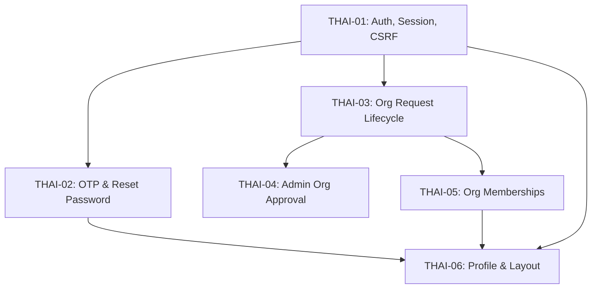

> **Convention:** Mỗi sub-issue checkout từ `dev` sang `feat/thai/<task-id>-<ten-ngan>`, commit theo Conventional Commits và mở PR về `dev`.
> **Merge gate:** Chỉ merge khi toàn bộ GitHub Actions xanh, test có bằng chứng và PR đã được người khác review.

## 1. Phạm vi sở hữu của Thái (Identity, Auth, Org Access, Admin Org Review)

Thái chịu trách nhiệm toàn bộ lớp nền tảng định danh, xác thực, quản lý phân quyền tổ chức và phê duyệt tổ chức:

- **UI-03:** Đăng ký, đăng nhập, quên/đặt lại mật khẩu, xác minh email qua OTP.
- **UI-09:** Người dùng gửi đơn yêu cầu thành lập tổ chức và theo dõi trạng thái.
- **UI-10 & UI-11:** Ngữ cảnh tổ chức, danh sách và quản lý thành viên tổ chức (gán role, kích hoạt/vô hiệu hóa).
- **UI-19:** Màn hình Admin hệ thống xét duyệt hoặc từ chối yêu cầu tạo tổ chức, thiết lập chính sách hoa hồng ban đầu (`CommissionRule`).
- **UI-24:** Trang hồ sơ cá nhân (`/profile`) và hiển thị huy hiệu xác minh email/quyền hạn.
- **Security Framework chung:** Quản lý HTTP Session an toàn, bảo vệ chống CSRF, đối soát `authVersion` chống stale session, envelope JSON chuẩn cho API.

## 2. Ranh giới hệ thống và file cấm sửa

- **Tuyệt đối không sửa:** Mọi file trong `*/model/*.java` (Model đã khóa schema), `pom.xml`, `src/main/resources/META-INF/persistence.xml`.
- **Không can thiệp vào:** `database/migrations/**` và `database/*.sql` trực tiếp từ PR tính năng (chỉ gọi Stored Procedure và View có sẵn).
- **Không can thiệp vào domain khác:**
  - Không sửa Event, Zone, Seat, Catalog (thuộc Đông - `event/**`).
  - Không sửa Ticket Hold, Order, VNPAY, Coupon (thuộc Liêm - `ticketing/**`, `order/**`, `payment/**`).
  - Không sửa Check-in, Refund, Cancellation (thuộc Khánh - `fulfillment/**`, `refund/**`).
  - Không sửa Commission Rule chung, Settlement, Payout, Report (thuộc Vương - `settlement/**`, `report/**`).
- **Ranh giới Admin:** Thái chỉ phụ trách endpoint và màn hình Admin duyệt tổ chức (`/api/admin/organization-requests/**` và UI-19). Không tạo chung `AdminServlet` hay `AdminService` dùng lẫn với các miền khác.

## 3. Danh sách Sub-issues

- [x] #1 **THAI-01:** Authentication, session, current user contract và CSRF filter.
- [x] #2 **THAI-02:** Dịch vụ OTP xác minh email, reset token mật khẩu và Socket SMTP.
- [ ] #3 **THAI-03:** Vòng đời yêu cầu tạo tổ chức (UI-09), requester context và idempotency.
- [ ] #4 **THAI-04:** Admin duyệt/từ chối tổ chức (UI-19), tích hợp Stored Procedure `dbo.sp_organization_approve`.
- [ ] #5 **THAI-05:** Membership và quản lý quyền trong tổ chức (UI-10/11), bảo vệ Manager cuối cùng.
- [ ] #6 **THAI-06:** Profile cá nhân (UI-24), chuyển đổi ngữ cảnh tổ chức và Layout dùng chung.

## 4. Thứ tự thực thi và phụ thuộc

## 5. Definition of Done (DOD) cho toàn bộ Epic

1. Hoàn thành 100% các endpoint, DTO, Service, Repository, JSP views và bộ kiểm thử của 6 sub-issues.
2. Bảo mật chặt chẽ: Không bao giờ lưu/trả/log plain password, hash nhạy cảm, OTP nguyên bản hay session id.
3. Chống rò rỉ phân quyền: Mọi quyền hạn (PlatformRole, OrganizationRole) được truy vấn trực tiếp từ database hoặc đối chiếu an toàn qua `authVersion`, không tin cậy dữ liệu client gửi lên.
4. Tương thích chuẩn SQL Server: Tích hợp đầy đủ các SP `dbo.sp_user_verify_email`, `dbo.sp_organization_submit_for_approval`, `dbo.sp_organization_approve`, `dbo.sp_organization_reject`.
5. Tất cả unit test, integration test chạy thành công (`mvn -B test` xanh 100%).
