<div align="center">

# 🎫 TicketsCenter

**Nền tảng bán vé sự kiện trực tuyến: khám phá sự kiện, giữ chỗ, thanh toán payOS, vé điện tử QR, soát vé, hoàn tiền và quyết toán cho ban tổ chức.**


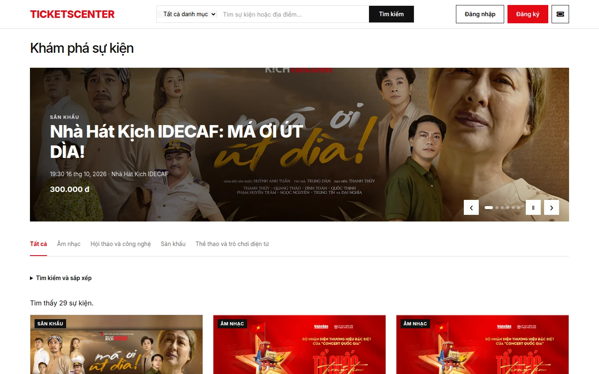

[Tính năng](#-tính-năng-theo-vai-trò) · [Kiến trúc](#-kiến-trúc) · [Cơ sở dữ liệu](#-sql-server-là-nơi-giữ-luật-nghiệp-vụ) · [Chạy local](#-chạy-local) · [Tài liệu](#-tài-liệu)

</div>

---

## 📌 Giới thiệu

TicketsCenter là đồ án môn **Hệ quản trị cơ sở dữ liệu (DBMS)**: một ứng dụng web Java thuần, không dùng Spring, gồm
**Servlet 6.1 / JSP / JSTL** chạy trên **Tomcat 11** và **JPA/Hibernate + HikariCP** kết nối **SQL Server (Azure SQL)**.

Điểm đặc trưng của dự án là **SQL Server nắm luật nghiệp vụ và phân quyền**. Mọi thao tác ghi đi qua stored procedure,
mọi thao tác đọc đi qua view/hàm có tham số. Trigger bảo vệ các bất biến như không bán trùng ghế, không sửa số tiền đã chốt
và nhật ký chỉ được ghi thêm. Java chỉ điều phối HTTP, phiên đăng nhập và tích hợp bên ngoài.

| | |
|---|---|
| 🧑‍🤝‍🧑 **4 vai trò** | Người mua · Quản lý tổ chức · Nhân viên soát vé · Quản trị nền tảng |
| 🖥️ **24 màn hình** | UI-01 → UI-24 theo [SPEC](docs/references/SPEC.md) §9 |
| 🗄️ **60 migration** | Hơn 100 procedure, ~70 view, hơn 20 hàm, 35 trigger, 6 role `tc_*` |
| 💳 **Thanh toán** | payOS (payment link + webhook + đối soát); hoàn tiền và chi trả được mô phỏng |

---

## ✨ Tính năng theo vai trò

> Ảnh chụp từ ứng dụng đang chạy với dữ liệu demo. Email, số điện thoại, mã vé và mã QR đã được che.

### 🛒 1. Khách và người mua vé

#### Khám phá và xem chi tiết sự kiện (UI-01, UI-02)
Trang chủ có banner nổi bật, lọc theo danh mục (Âm nhạc, Sân khấu, Hội thảo, Thể thao...), tìm kiếm theo tên hoặc địa điểm
và sắp xếp. Trang chi tiết hiển thị lịch diễn, địa điểm, ban tổ chức, thời gian mở bán, giá từ thấp nhất và tình trạng từng khu.

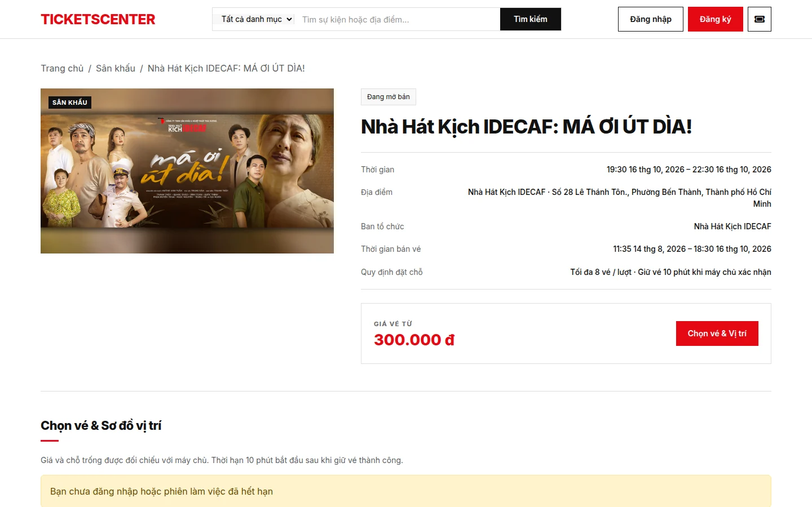

#### Chọn vé và giữ chỗ (UI-02, UI-04)
Người mua chọn khu (vé đứng hoặc ghế ngồi trên sơ đồ), tối đa **8 vé mỗi lượt**. Máy chủ đối chiếu giá và chỗ trống rồi
**giữ vé trong 10 phút**. Có thể *Thanh toán ngay* hoặc *Giữ vé, thanh toán sau*. Ở bước checkout, hệ thống chỉ gợi ý những mã
giảm giá đơn hàng đủ điều kiện dùng; mức giảm tối đa là 30%.

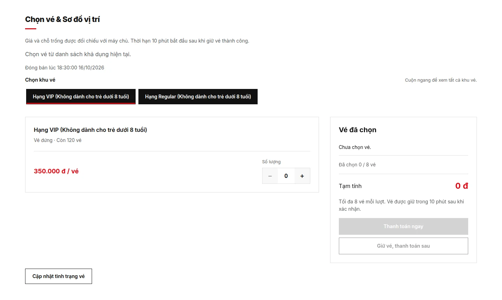

#### Tài khoản: đăng nhập, đăng ký, OTP, đặt lại mật khẩu (UI-03)

<table>
  <tr>
    <td width="33%">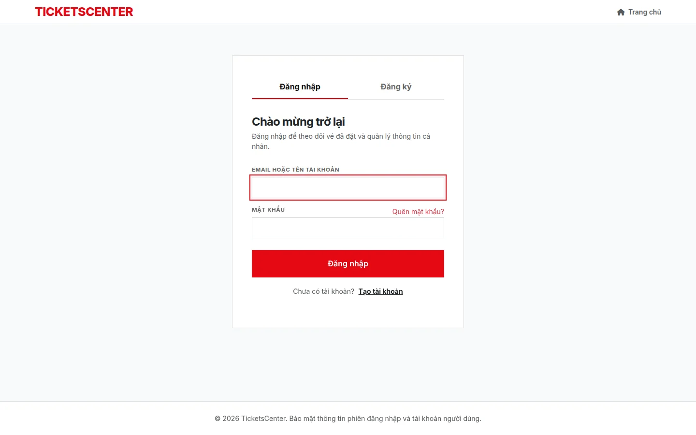</td>
    <td width="33%">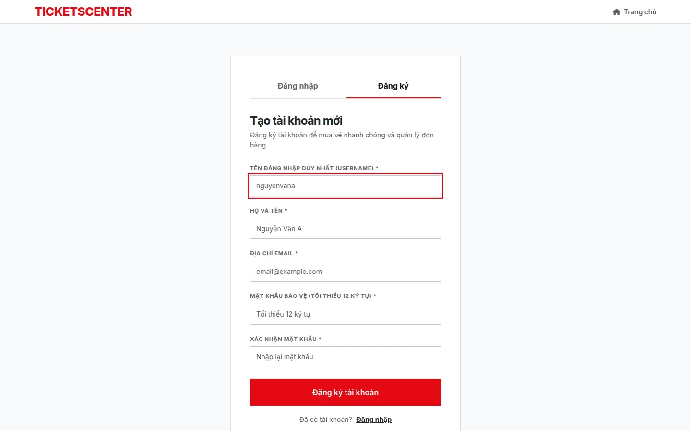</td>
    <td width="33%">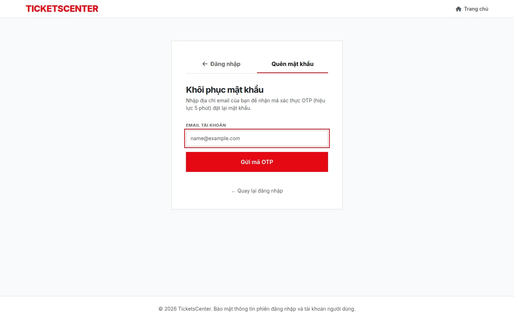</td>
  </tr>
  <tr>
    <td align="center"><b>Đăng nhập</b><br><sub>Email hoặc username, CSRF theo phiên</sub></td>
    <td align="center"><b>Đăng ký</b><br><sub>Mật khẩu ≥ 12 ký tự, xác minh email bằng OTP</sub></td>
    <td align="center"><b>Quên mật khẩu</b><br><sub>OTP dùng một lần, có giới hạn tần suất</sub></td>
  </tr>
</table>

#### Đơn hàng, vé điện tử và mã QR (UI-05, UI-06, UI-07)
Đơn hàng được lọc theo trạng thái *Đã thanh toán / Chờ thanh toán / Đã hủy / Hết hạn*. Khi thanh toán thành công, mỗi vé có
một mã QR được ký số để xuất trình lúc vào cửa.

<table>
  <tr>
    <td width="50%">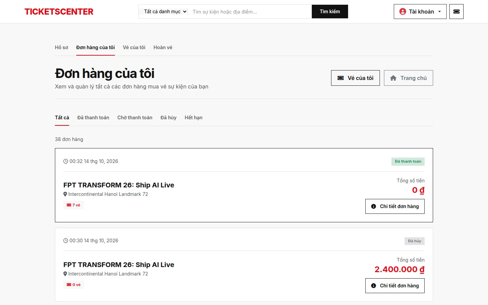</td>
    <td width="50%">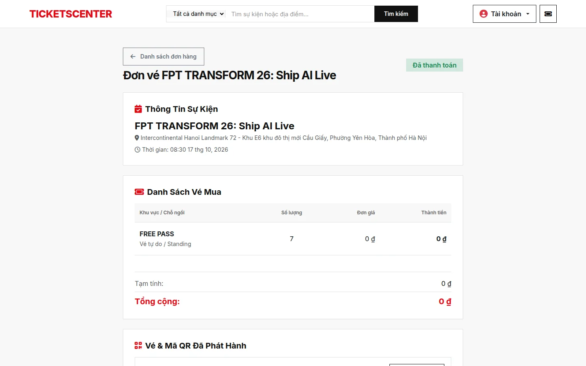</td>
  </tr>
  <tr>
    <td align="center"><b>Đơn hàng của tôi</b></td>
    <td align="center"><b>Chi tiết đơn</b>: vé mua, giảm giá, tổng tiền</td>
  </tr>
  <tr>
    <td width="50%">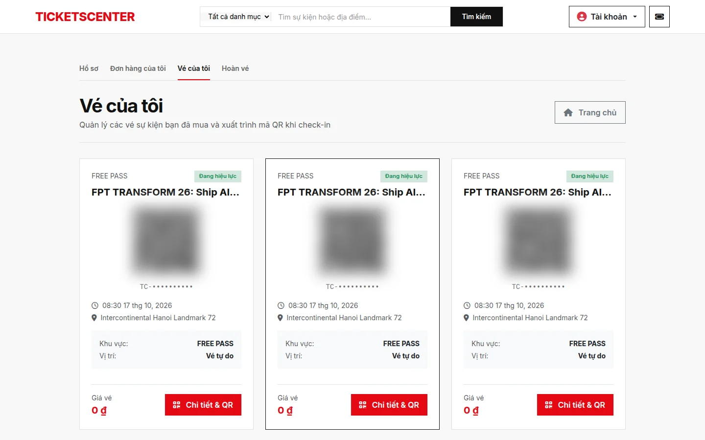</td>
    <td width="50%">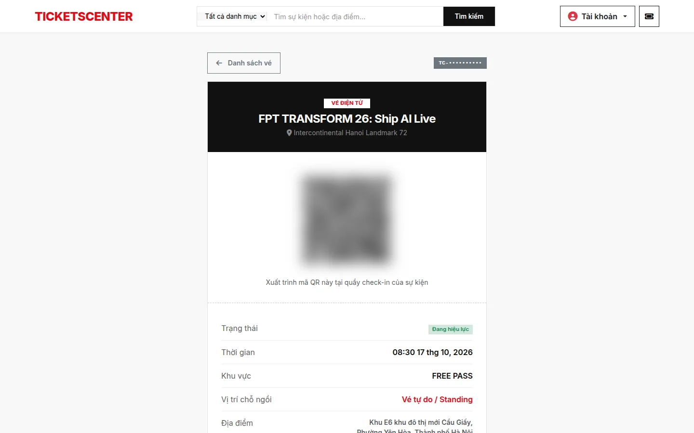</td>
  </tr>
  <tr>
    <td align="center"><b>Vé của tôi</b></td>
    <td align="center"><b>Vé điện tử</b>: QR, khu vực, chỗ ngồi</td>
  </tr>
</table>

#### Hồ sơ, hoàn vé và đăng ký làm ban tổ chức (UI-08, UI-09, UI-24)
Người mua có thể yêu cầu hoàn vé chưa sử dụng trước giờ diễn. Bất kỳ người dùng nào cũng có thể gửi hồ sơ đăng ký trở thành
**đối tác ban tổ chức**. Khi quản trị viên duyệt, người gửi hồ sơ trở thành Manager của tổ chức đó.

<table>
  <tr>
    <td width="50%">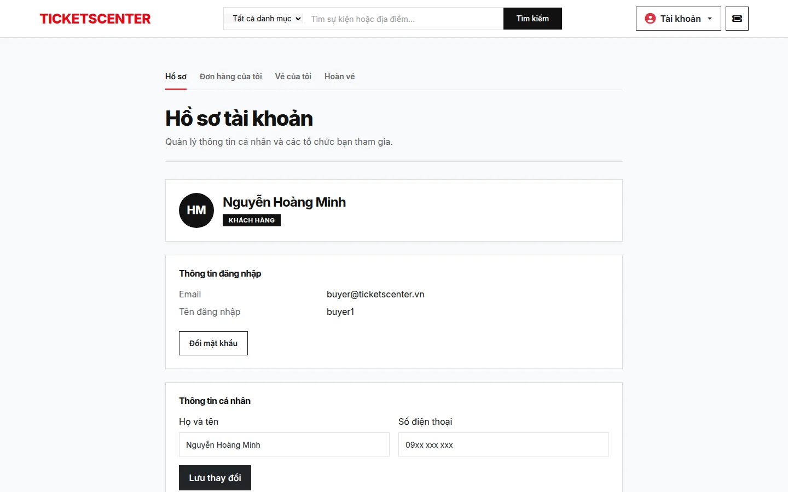</td>
    <td width="50%">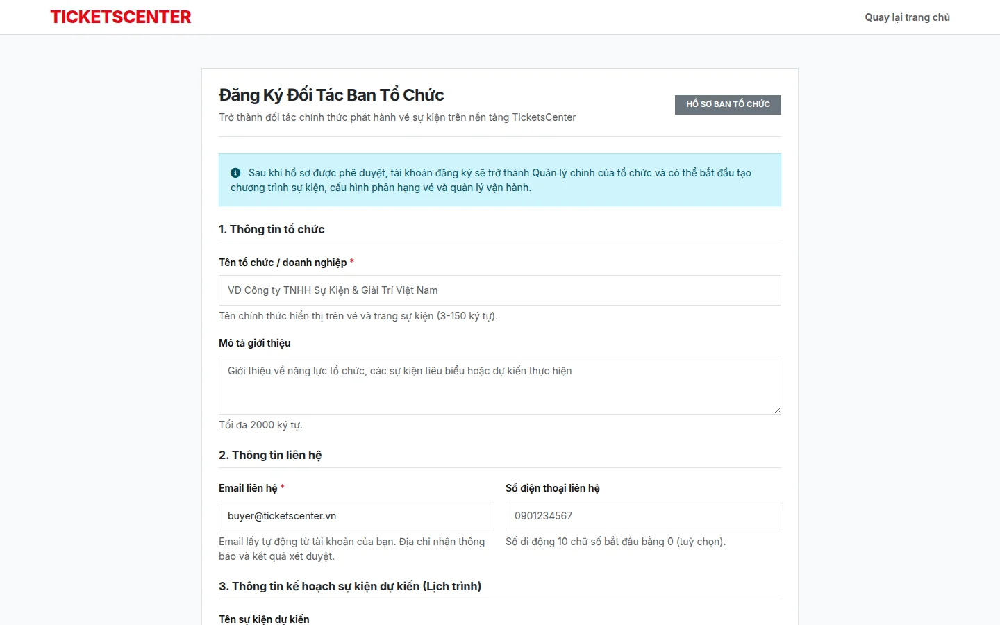</td>
  </tr>
  <tr>
    <td align="center"><b>Hồ sơ tài khoản</b></td>
    <td align="center"><b>Đăng ký đối tác ban tổ chức</b></td>
  </tr>
</table>

---

### 🏢 2. Quản lý tổ chức (Manager)

#### Tổng quan tổ chức (UI-10)
Số sự kiện, số sự kiện chờ duyệt, số đơn đã thanh toán, doanh thu lũy kế, dòng tiền ròng và biểu đồ 7 ngày gần nhất.
Một người có thể quản lý nhiều tổ chức và chuyển qua lại bằng bộ chọn.

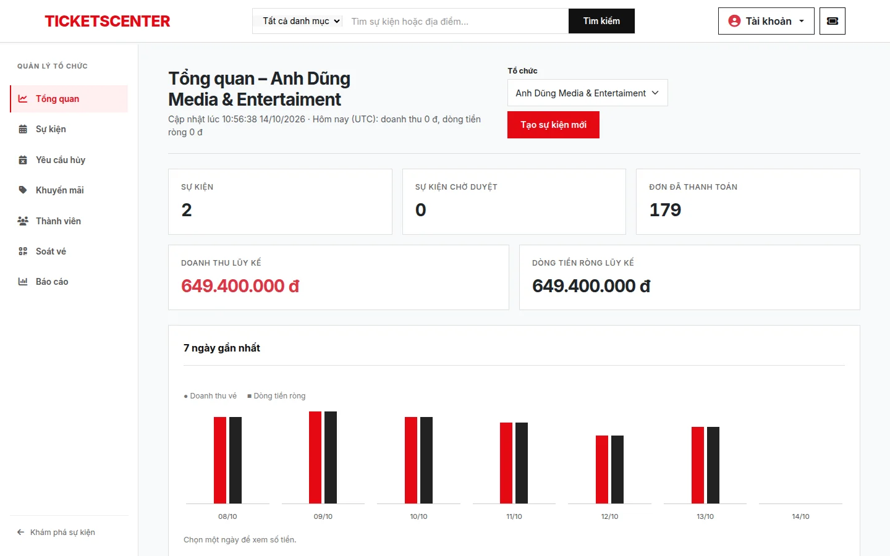

#### Sự kiện, khu vé và sơ đồ ghế (UI-12, UI-13)
Manager tạo hồ sơ sự kiện (ảnh bìa, danh mục, địa điểm, lịch mở bán), thêm **khu ghế ngồi** (số hàng × ghế mỗi hàng) hoặc
**khu vé đứng** (sức chứa), rồi gửi duyệt. Sau khi công khai, bố cục bị khóa: chỉ được sửa giá, còn chỗ đã giữ hoặc đã bán thì
được trigger bảo vệ.

<table>
  <tr>
    <td width="50%">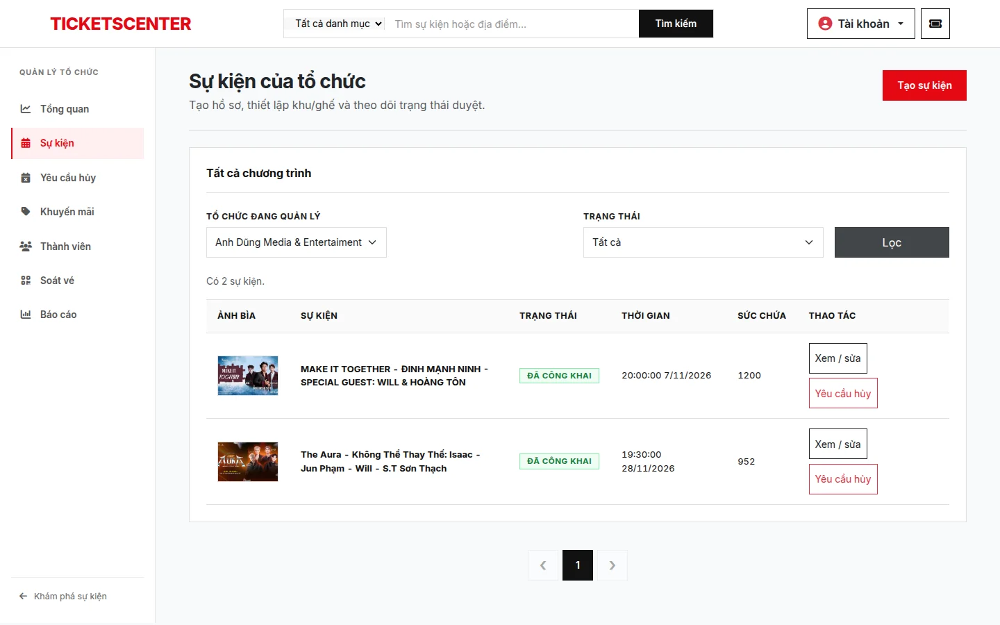</td>
    <td width="50%">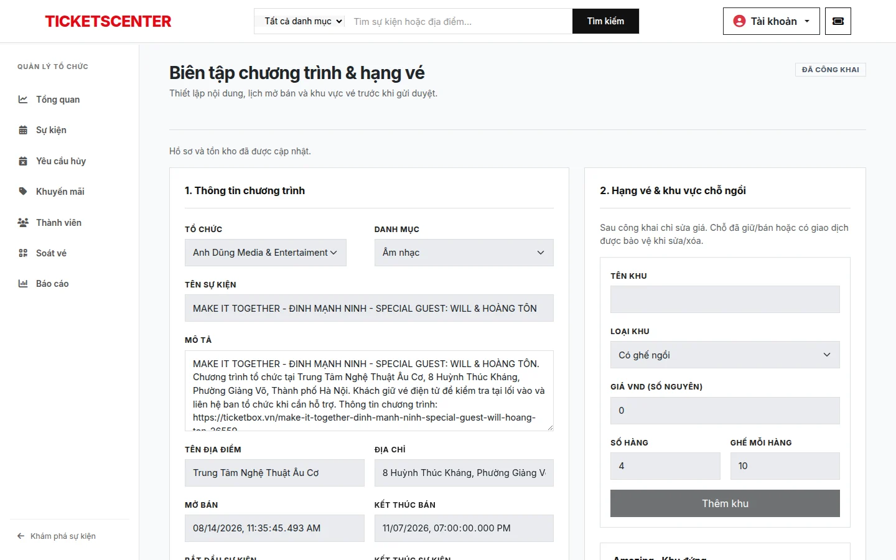</td>
  </tr>
  <tr>
    <td align="center"><b>Sự kiện của tổ chức</b>: trạng thái duyệt</td>
    <td align="center"><b>Biên tập chương trình và hạng vé</b></td>
  </tr>
</table>

#### Thành viên, báo cáo, mã giảm giá và yêu cầu hủy (UI-11, UI-14, UI-17)

<table>
  <tr>
    <td width="50%">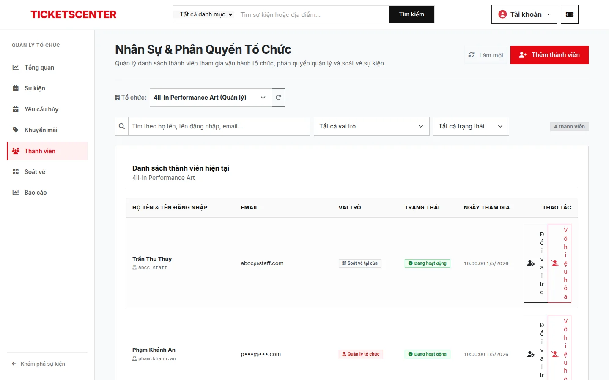</td>
    <td width="50%">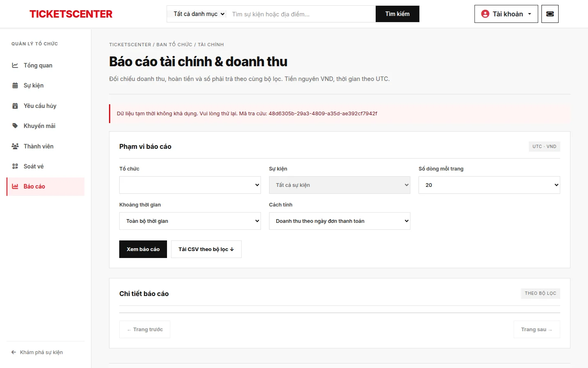</td>
  </tr>
  <tr>
    <td align="center"><b>Nhân sự và phân quyền</b><br><sub>Manager / Soát vé; không thể gỡ Manager cuối cùng</sub></td>
    <td align="center"><b>Báo cáo doanh thu</b><br><sub>Doanh thu, hoàn tiền, hoa hồng; xuất CSV</sub></td>
  </tr>
</table>

- **Mã khuyến mãi**: tạo mã theo phần trăm hoặc số tiền cố định, giới hạn lượt dùng và thời hạn, theo dõi số lượt đã dùng.
- **Yêu cầu hủy sự kiện**: gửi yêu cầu để quản trị viên xem xét. Khi hủy được duyệt, worker hoàn tiền tự động cho từng đơn.

---

### 📱 3. Nhân viên soát vé (Check-in staff)

Nhân viên chọn sự kiện của tổ chức mình (có số vé đã phát hành và số người đã vào cửa), rồi quét QR bằng camera, chọn ảnh QR
hoặc nhập mã vé. Cổng chỉ mở trong khung giờ check-in. Mỗi vé chỉ check-in thành công **một lần**, kể cả khi nhiều thiết bị
quét cùng lúc.

<table>
  <tr>
    <td width="50%">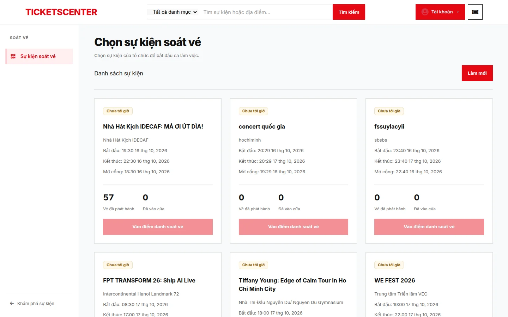</td>
    <td width="50%">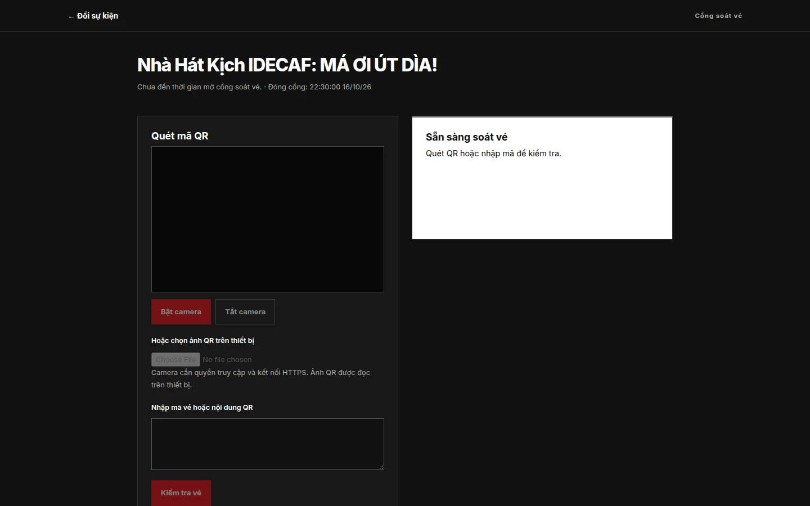</td>
  </tr>
  <tr>
    <td align="center"><b>Chọn sự kiện soát vé</b> (UI-15)</td>
    <td align="center"><b>Cổng soát vé QR</b> (UI-16)</td>
  </tr>
</table>

---

### 🛡️ 4. Quản trị nền tảng (Admin)

#### Tổng quan hệ thống (UI-18)
Các hàng đợi cần xử lý (tổ chức và sự kiện chờ duyệt, yêu cầu hoàn vé, quyết toán nháp), quy mô hệ thống và tài chính lũy kế
toàn sàn.

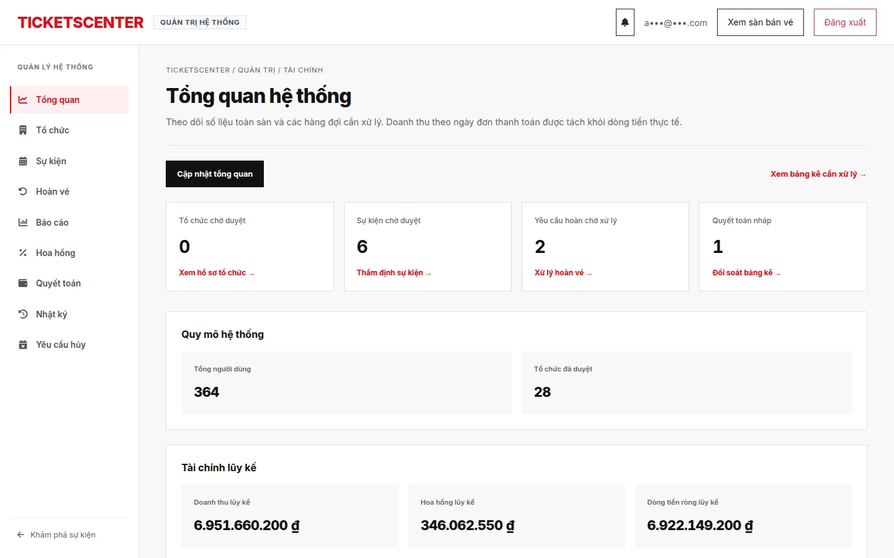

#### Duyệt tổ chức, sự kiện và hoàn tiền (UI-19, UI-20, UI-21)

<table>
  <tr>
    <td width="50%">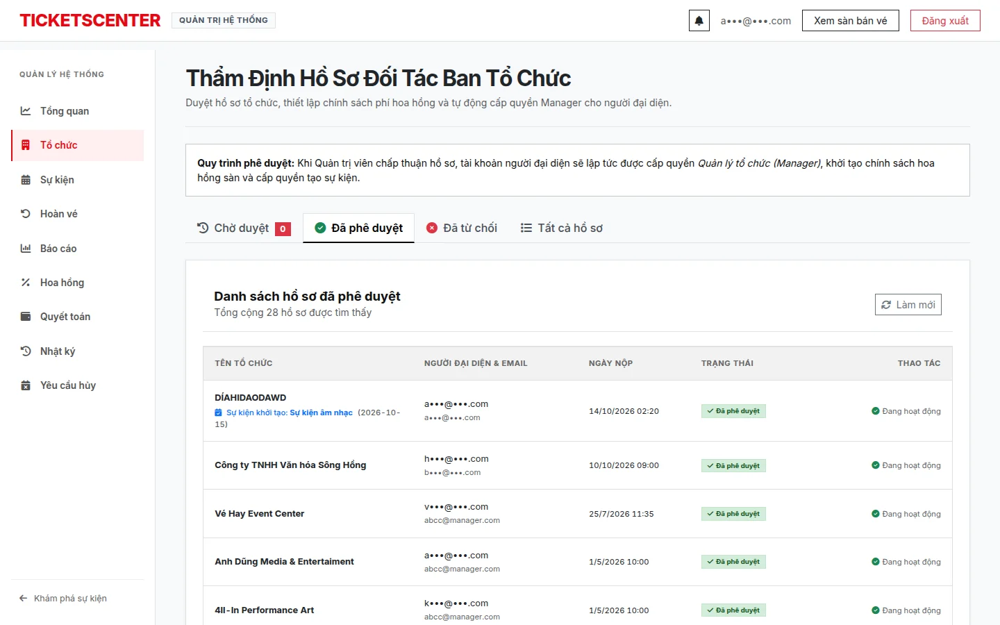</td>
    <td width="50%">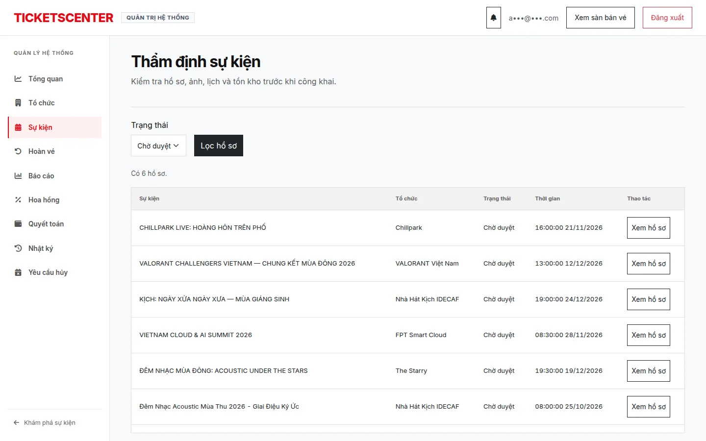</td>
  </tr>
  <tr>
    <td align="center"><b>Thẩm định ban tổ chức</b><br><sub>Duyệt kèm chính sách hoa hồng ban đầu</sub></td>
    <td align="center"><b>Thẩm định sự kiện</b><br><sub>Công khai, từ chối có lý do, hủy sự kiện</sub></td>
  </tr>
  <tr>
    <td width="50%">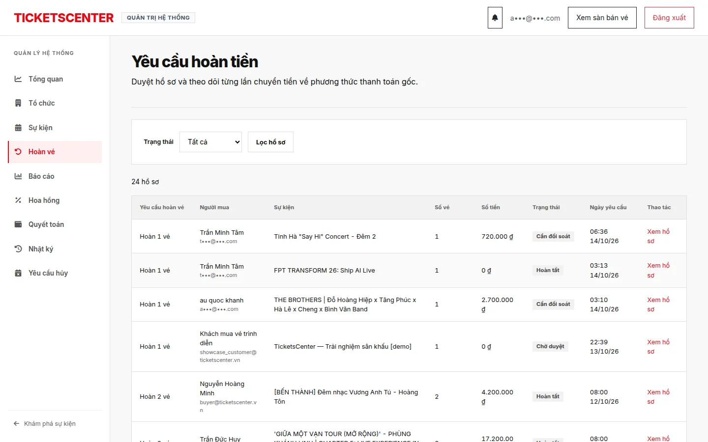</td>
    <td width="50%">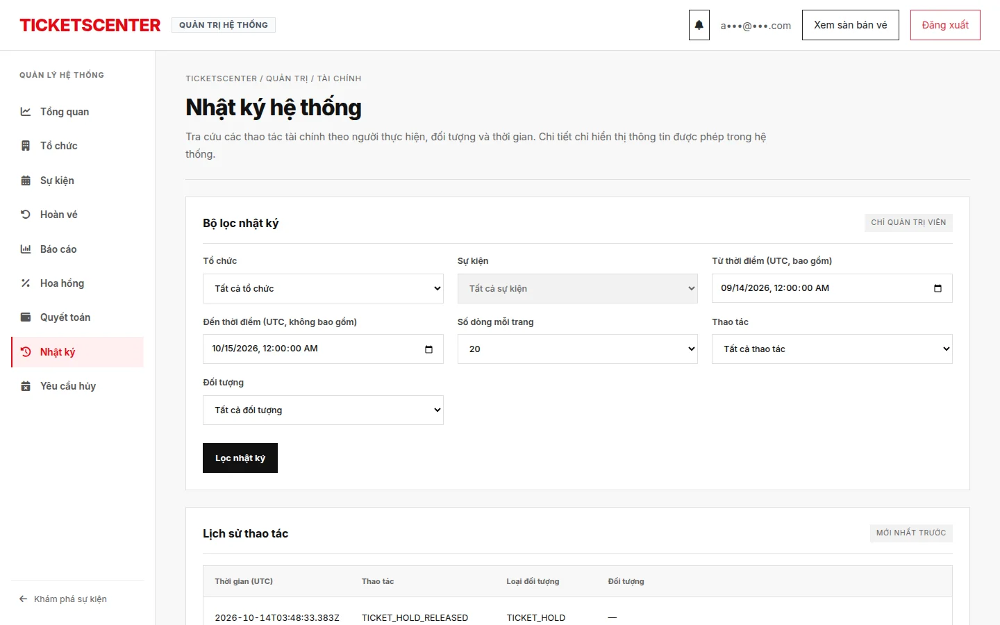</td>
  </tr>
  <tr>
    <td align="center"><b>Yêu cầu hoàn tiền</b><br><sub>Duyệt/từ chối, theo dõi từng lần chuyển tiền</sub></td>
    <td align="center"><b>Nhật ký hệ thống</b><br><sub>Chỉ ghi thêm (trigger <code>trg_AuditLog_AppendOnly</code>)</sub></td>
  </tr>
</table>

#### Hoa hồng, quyết toán và báo cáo (UI-22, UI-23)

<table>
  <tr>
    <td width="33%">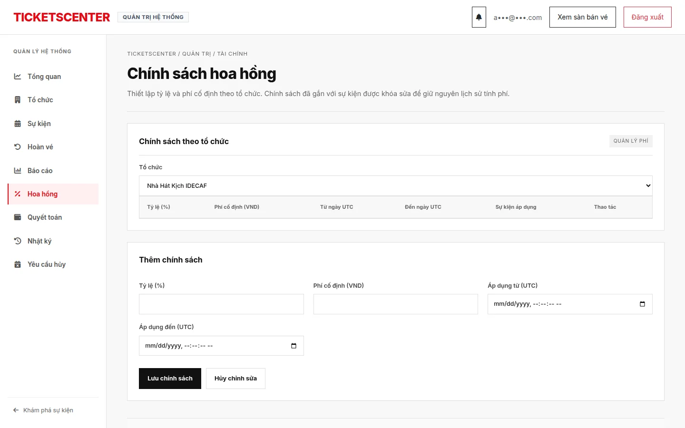</td>
    <td width="33%">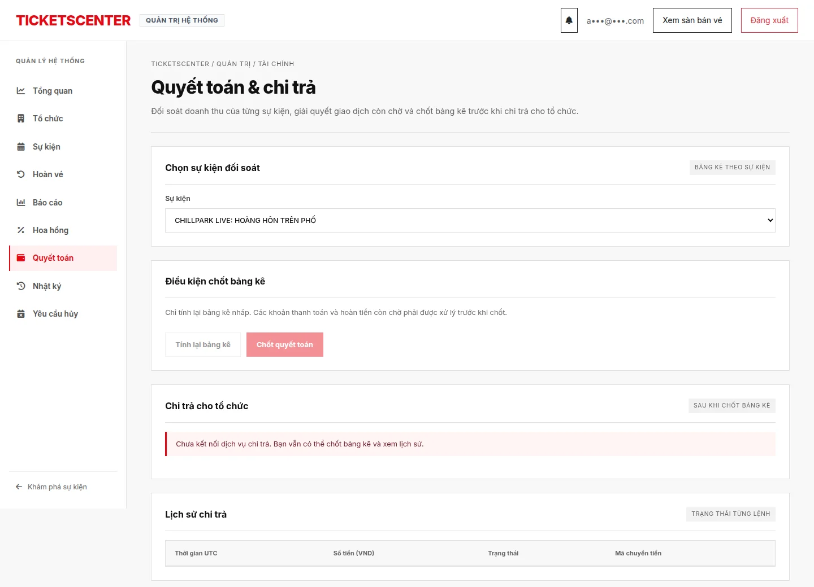</td>
    <td width="33%">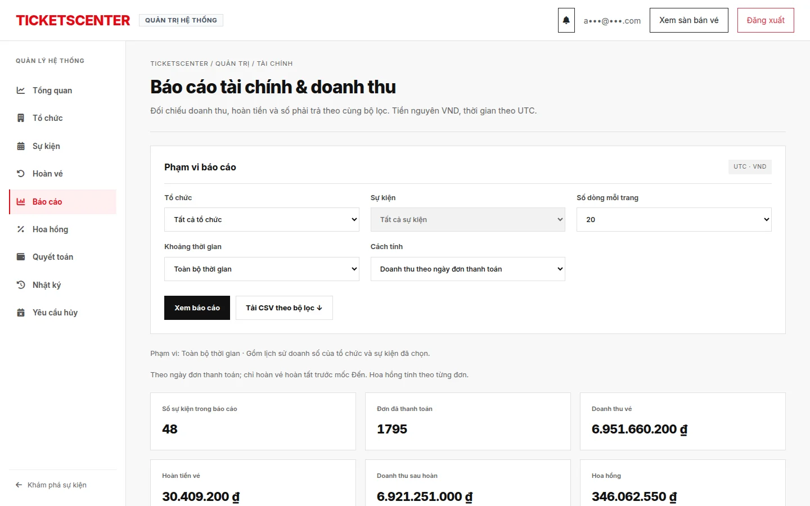</td>
  </tr>
  <tr>
    <td align="center"><b>Chính sách hoa hồng</b><br><sub>Tỷ lệ % + phí cố định; khóa sửa khi đã áp dụng</sub></td>
    <td align="center"><b>Quyết toán và chi trả</b><br><sub>Tính lại, chốt bảng kê, chi trả cho tổ chức</sub></td>
    <td align="center"><b>Báo cáo toàn hệ thống</b><br><sub>Lọc theo tổ chức/sự kiện/thời gian; xuất CSV</sub></td>
  </tr>
</table>

---

## 🏗️ Kiến trúc

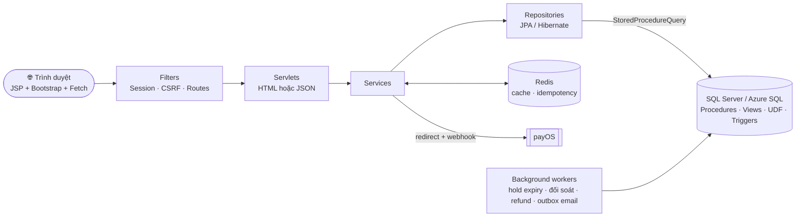

- **Package-by-feature** trong `src/main/java/vn/ticketscenter/`: `identity`, `event`, `ticketing`, `order`, `payment`,
  `fulfillment` (vé/check-in/hoàn), `settlement`, `organizer`, `admin`, `audit`, `report`, `dashboard`, `storage`, `config`,
  `persistence`. Mỗi feature có các tầng `controller` / `service` / `repository` / `model` / `dto`. `FeaturePackageStructureTest`
  kiểm tra cấu trúc này.
- **Một route, hai dạng trả về**: mặc định trả trang JSP trong `WEB-INF/views/<feature>/`; khi gửi `Accept: application/json`
  thì trả DTO trong envelope `{"data": …}` hoặc `{"error": {code, message, correlationId}}`. Swagger dùng
  `src/main/resources/openapi.json`.
- **Tiền** lưu bằng `decimal(19,0)` VND (`BigDecimal`, JSON dạng chuỗi). **Thời gian** lưu dạng `Instant` theo UTC.

### Luồng mua vé

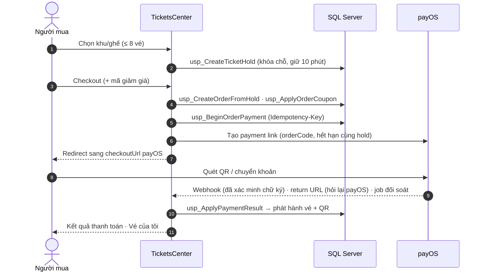

## 🧭 Cấu trúc thư mục

```text
TicketCenter/
├── src/main/java/vn/ticketscenter/   # Package-by-feature (identity, event, order, payment, ...)
├── src/main/webapp/
│   ├── WEB-INF/views/                # JSP theo feature
│   └── assets/                       # CSS, JS (chọn ghế, đồng hồ giữ vé, quét QR)
├── src/main/resources/openapi.json   # Đặc tả API cho Swagger
├── database/
│   ├── migrations/                   # 001 → 068 + APPLY_ORDER.md
│   ├── tests/                        # Test SQL (THROW khi fail)
│   └── backup_recovery/
├── tools/                            # Script chạy local, acceptance, benchmark
├── docs/                             # SPEC, runbook, evidence, báo cáo
└── .github/workflows/                # CI: chất lượng, test, CVE scan, Docker, deploy
```

---

## 📚 Tài liệu

| Tài liệu | Nội dung |
|---|---|
| [SPEC.md](docs/references/SPEC.md) | Đặc tả nghiệp vụ, đây là nguồn chuẩn |
| [COVERAGE.md](docs/references/COVERAGE.md) | Danh mục đối tượng SQL bắt buộc |
| [API-MAP.md](docs/references/API-MAP.md) | Bản đồ route cho 24 màn hình |
| [CONVENTIONS.md](docs/references/CONVENTIONS.md) | Quy ước code và hợp đồng HTTP |
| [diagram.md](docs/classdiagram/diagram.md) | Class diagram |
| [database-runbook.md](docs/backend/database-runbook.md) | Áp dụng migration, backup và khôi phục |
| [running-web.md](docs/backend/running-web.md) · [deployment.md](docs/backend/deployment.md) | Chạy web và triển khai |
| [backend-acceptance.md](docs/evidence/backend-acceptance.md) | Bằng chứng nghiệm thu |

---

## 🤝 Quy trình đóng góp

GitFlow-lite: `main` ← `develop` ← `feature/<tên>/<task-id>-<mô-tả>`. PR nhắm vào `develop`; nghiệm thu bằng merge
`develop → main` kèm tag. Commit theo conventional commits (`feat(scope):`, `fix(scope):`, `refactor(db):`).
Bằng chứng cho mỗi task đặt ở `docs/evidence/<owner>/<TASK-ID>.md`.

<div align="center">
<sub>TicketsCenter · Đồ án DBMS · 2026</sub>
</div>
