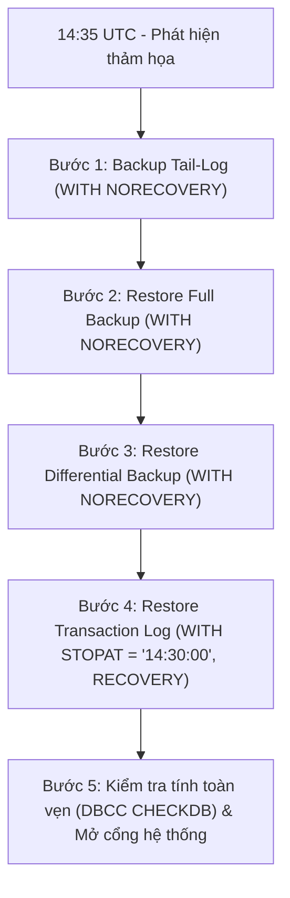

# Kế hoạch & Chiến lược Sao lưu và Phục hồi Dữ liệu (Backup & Recovery Plan)

> **Hệ thống:** Nền tảng bán vé trực tuyến TicketsCenter  
> **Cơ sở dữ liệu:** Microsoft SQL Server / Azure SQL Database (`TicketCenterticke` & `TicketsCenter_Dev`)  
> **Tài liệu tham chiếu:** [`docs/references/SPEC.md`](../references/SPEC.md) (Mục 14.9, 15.3), [`docs/baocao/THIET-KE-DU-LIEU.md`](THIET-KE-DU-LIEU.md)

---

## 1. Mục tiêu và Chỉ số An toàn Dữ liệu (RPO & RTO)

Là một hệ thống giao dịch thương mại điện tử và bán vé sự kiện theo thời gian thực với lượng giao dịch tài chính cao, chiến lược sao lưu và phục hồi của TicketsCenter được thiết kế nhằm đạt được 2 chỉ số then chốt:

- **RPO (Recovery Point Objective) $\le 15$ phút:**  
  Trong trường hợp xảy ra thảm họa phần cứng, tấn công mã độc hoặc sai sót dữ liệu nghiêm trọng, lượng dữ liệu bị mất mát tối đa không vượt quá 15 phút giao dịch gần nhất nhờ cơ chế sao lưu nhật ký giao dịch liên tục (**Transaction Log Backup**).
- **RTO (Recovery Time Objective) $\le 30$ phút:**  
  Thời gian tối đa để đội ngũ vận hành đưa hệ thống cơ sở dữ liệu trở lại trạng thái sẵn sàng phục vụ người dùng kể từ thời điểm phát hiện sự cố.

---

## 2. Chiến lược Sao lưu Định kỳ (Backup Strategy)

Hệ thống áp dụng mô hình sao lưu kết hợp nhiều cấp độ theo nguyên tắc **3-2-1** (3 bản sao, 2 loại phương tiện lưu trữ, 1 bản lưu ngoài site):

| Loại sao lưu | Tần suất | Thời điểm thực hiện | Thời gian lưu trữ (Retention) | Mục đích sử dụng |
|---|---|---|---|---|
| **Full Backup** (Toàn phần) | 1 lần / tuần | Chủ Nhật (01:00 UTC) | 4 tuần gần nhất | Bản gốc chuẩn cho toàn bộ chuỗi khôi phục (Base Backup). |
| **Differential Backup** (Vi sai) | 1 lần / ngày | Thứ Hai – Thứ Bảy (01:00 UTC) | 14 ngày | Chứa các thay đổi so với bản Full gần nhất, giúp rút ngắn thời gian Restore. |
| **Transaction Log Backup** | 15 phút / lần | Liên tục 24/7 | 7 ngày | Thu thập toàn bộ log giao dịch phát sinh, phục vụ **Point-In-Time Recovery (PITR)**. |
| **BACPAC Export** (Cold/Archive) | Định kỳ trước mỗi bản release lớn | Thủ công / CI pipeline | Lưu trữ lâu dài (Blob Storage) | Đóng gói schema + data thành 1 file độc lập phục vụ lưu trữ ngoại tuyến và nộp bài. |

> [!IMPORTANT]
> **Yêu cầu Recovery Model:**  
> Cơ sở dữ liệu TicketsCenter bắt buộc phải được cấu hình ở chế độ **`FULL` Recovery Model** để duy trì đầy đủ Transaction Log chain, cho phép thực hiện Log Backup và khôi phục tới từng giây (`STOPAT`).

---

## 3. Cấu trúc Script & Bộ công cụ trong Source Code

Toàn bộ script sao lưu và phục hồi được quản lý thống nhất trong thư mục [`database/backup_recovery/`](file:///home/dell/Documents/projects/TicketCenter/database/backup_recovery/):

```
database/backup_recovery/
├── 01_backup_full.sql             # T-SQL tạo Full Backup kèm nén (COMPRESSION) và kiểm tra CHECKSUM
├── 02_backup_diff.sql             # T-SQL tạo Differential Backup
├── 03_backup_log.sql              # T-SQL tạo Transaction Log Backup (tự động bật FULL recovery model nếu chưa có)
├── 04_point_in_time_recovery.sql  # T-SQL kịch bản mô phỏng khôi phục thảm họa với STOPAT
└── export_bacpac.sh               # Shell script tự động xuất/nhập BACPAC từ Azure SQL / Local
```

---

## 4. Kịch bản Diễn tập Phục hồi Thảm họa (Disaster Recovery Drill)

### 4.1. Tình huống giả định
- **01:00 UTC:** Hệ thống hoàn thành bản **Full Backup**.
- **12:00 UTC:** Hệ thống hoàn thành bản **Differential Backup**.
- **14:15 UTC:** Hệ thống hoàn thành bản **Transaction Log Backup** định kỳ.
- **14:30:15 UTC (Thời điểm thảm họa $T_{disaster}$):** Do sơ suất của quản trị viên hoặc lỗi script, bảng `tc_tickets` bị cập nhật sai hoặc xóa nhầm hàng loạt dữ liệu vé sự kiện.
- **14:35 UTC:** Phát hiện sự cố. Đội ngũ DevOps kích hoạt quy trình Disaster Recovery để khôi phục cơ sở dữ liệu về thời điểm **`14:30:00 UTC`** (15 giây trước khi xảy ra thảm họa).

### 4.2. Quy trình 5 bước thực hiện khôi phục



#### Bước 1: Sao lưu Tail-Log (Nhật ký giao dịch cuối cùng)
Khóa kết nối và sao lưu phần log chưa được lưu trữ, giữ DB ở trạng thái phục hồi:
```sql
USE master;
ALTER DATABASE [TicketsCenter_Dev] SET SINGLE_USER WITH ROLLBACK IMMEDIATE;

BACKUP LOG [TicketsCenter_Dev]
TO DISK = N'/var/opt/mssql/backup/TicketsCenter_Dev_TailLog.trn'
WITH NORECOVERY, FORMAT, INIT, COMPRESSION, CHECKSUM;
```

#### Bước 2: Khôi phục bản Full Backup gần nhất
```sql
RESTORE DATABASE [TicketsCenter_Dev]
FROM DISK = N'/var/opt/mssql/backup/TicketsCenter_Dev_Full.bak'
WITH REPLACE, NORECOVERY, CHECKSUM;
```

#### Bước 3: Khôi phục bản Differential Backup gần nhất
```sql
RESTORE DATABASE [TicketsCenter_Dev]
FROM DISK = N'/var/opt/mssql/backup/TicketsCenter_Dev_Diff.bak'
WITH NORECOVERY, CHECKSUM;
```

#### Bước 4: Khôi phục Transaction Log và dừng lại tại thời điểm an toàn (`STOPAT`)
```sql
RESTORE LOG [TicketsCenter_Dev]
FROM DISK = N'/var/opt/mssql/backup/TicketsCenter_Dev_TailLog.trn'
WITH STOPAT = '2026-10-10 14:30:00', RECOVERY, CHECKSUM;

ALTER DATABASE [TicketsCenter_Dev] SET MULTI_USER;
```

#### Bước 5: Đối soát sau phục hồi
- Chạy `DBCC CHECKDB(N'TicketsCenter_Dev') WITH NO_INFOMSGS;` để đảm bảo không có lỗi phân bổ trang (page allocation).
- Chạy test kiểm thử nghiệp vụ: `mvn test -Dtest=MigrationSuiteVerificationTest` để đối soát toàn bộ schema và catalog.

---

## 5. Đặc thù Môi trường Azure SQL Database (Live Production)

Trên môi trường điện toán đám mây Azure SQL Database (`TicketCenterticke`), nền tảng Azure PaaS tự động cung cấp:

1. **Automated Point-in-Time Restore (PITR):**
   - Tự động sao lưu Full hàng tuần, Diff mỗi 12–24h, Transaction Log mỗi 5–10 phút.
   - Cho phép khôi phục về bất kỳ giây nào trong 7 ngày gần nhất trực tiếp qua Azure Portal hoặc Azure CLI:
     ```bash
     az sql db restore \
         --resource-group rg-ticketscenter \
         --server devonxjz \
         --name TicketCenterticke \
         --dest-name TicketCenterticke_Restored \
         --time "2026-10-10T14:30:00Z"
     ```
2. **Xuất file BACPAC độc lập:**
   - Sử dụng script [`export_bacpac.sh`](file:///home/dell/Documents/projects/TicketCenter/database/backup_recovery/export_bacpac.sh) để trích xuất toàn bộ schema và dữ liệu thành tệp nén `.bacpac` duy nhất nhằm lưu trữ offsite hoặc nộp bài báo cáo môn học.

---

## 6. Chính sách Bảo mật cho Dữ liệu Sao lưu

- **Không lưu trữ mật khẩu trong script:** Tất cả script sao lưu và nạp dữ liệu nhận thông tin đăng nhập qua biến môi trường (`TC_SQL_PASSWORD`), không commit credentials vào Git.
- **Phân quyền tối thiểu:** Lệnh `BACKUP` chỉ được thực hiện bởi tài khoản có quyền hệ thống (`sysadmin`, `db_backupoperator` hoặc `tc_platform_admin`). Các tài khoản ứng dụng như `tc_buyer`, `tc_checkin`, `tc_manager` tuyệt đối không được cấp quyền sao lưu/khôi phục.
- **Mã hóa (Encryption):** Bản sao lưu Full/Diff trên đĩa lưu trữ được khuyến nghị cấu hình mã hóa Transparent Data Encryption (TDE) hoặc Backup Encryption (`WITH ENCRYPTION`).
