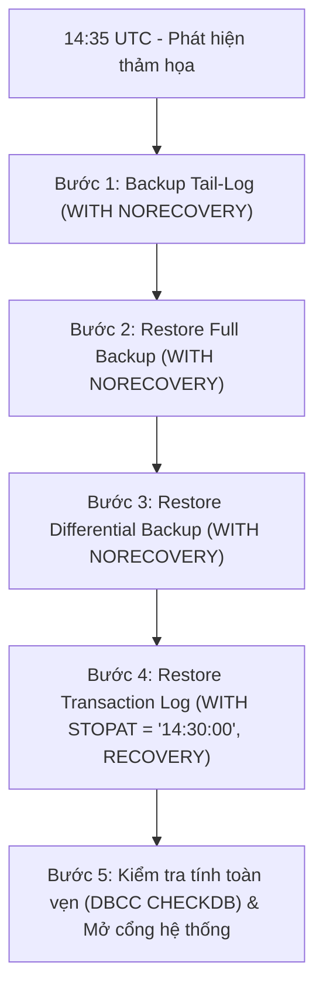

# TÀI LIỆU VẤN ĐÁP CƠ SỞ DỮ LIỆU CUỐI KỲ
## HỆ THỐNG QUẢN LÝ VÀ PHÂN PHỐI VÉ SỰ KIỆN TRỰC TUYẾN - TICKETSCENTER

> **Hệ quản trị CSDL:** Microsoft SQL Server / Azure SQL Database (`TicketsCenter` & `TicketsCenter_Dev`)  
> **Dự án:** TicketsCenter (Java Servlet / Jakarta EE + MS SQL Server + Redis)  
> **Mục tiêu tài liệu:** Báo cáo, thuyết trình và bảo vệ đồ án / thi vấn đáp cuối kỳ môn Cơ sở dữ liệu, Hệ cơ sở dữ liệu nâng cao, An toàn dữ liệu & Phát triển ứng dụng Web.

---

## MỤC LỤC
1. [PHẦN I: TỔNG QUAN KIẾN TRÚC CƠ SỞ DỮ LIỆU & CHIẾN LƯỢC THIẾT KẾ](#phần-i-tổng-quan-kiến-trúc-cơ-sở-dữ-liệu--chiến-lược-thiết-kế)
2. [PHẦN II: 10 CỤM CHỨC NĂNG NGHIỆP VỤ - BẢNG TỔNG HỢP & PHÂN TÍCH CODE](#phần-ii-10-cụm-chức-năng-nghiệp-vụ---bảng-tổng-hợp--phân-tích-code)
3. [PHẦN III: AN NINH & PHÂN QUYỀN HỆ THỐNG TRÊN SQL SERVER (DATABASE RBAC & SECURITY)](#phần-iii-an-ninh--phân-quyền-hệ-thống-trên-sql-server-database-rbac--security)
4. [PHẦN IV: CHIẾN LƯỢC SAO LƯU & PHỤC HỒI THẢM HỌA (BACKUP & DISASTER RECOVERY)](#phần-iv-chiến-lược-sao-lưu--phục-hồi-thảm-họa-backup--disaster-recovery)
5. [PHẦN V: BỘ CÂU HỎI VẤN ĐÁP THƯỜNG GẶP (ORAL EXAM DEFENSE Q&A)](#phần-v-bộ-câu-hỏi-vấn-đáp-thường-gặp-oral-exam-defense-qa)
6. [PHẦN VI: HƯỚNG DẪN TRUY XUẤT MÃ NGUỒN ĐỐI CHIẾU](#phần-vi-hướng-dẫn-truy-xuất-mã-nguồn-đối-chiếu)

---

## PHẦN I: TỔNG QUAN KIẾN TRÚC CƠ SỞ DỮ LIỆU & CHIẾN LƯỢC THIẾT KẾ

### 1. Tại sao hệ thống lại sử dụng Stored Procedure, Function, View và Trigger dày đặc?
Khi giảng viên hỏi: *"Tại sao nhóm không viết toàn bộ nghiệp vụ ở tầng ứng dụng (Java Backend / ORM) mà lại đẩy nhiều logic xuống Database?"*, đây là 4 luận điểm then chốt:

1. **Bảo đảm toàn vẹn giao dịch và Tính nhất quán ACID cao nhất:**
   Các nghiệp vụ như **giữ chỗ vé (concurrency hold)**, **thanh toán**, **soát vé (check-in)** và **hoàn tiền** có tính cạnh tranh dữ liệu cực cao. Việc xử lý trực tiếp tại Database Engine giúp tận dụng tối đa cơ chế khóa cấp hàng (*Pessimistic Locking*: `UPDLOCK`, `HOLDLOCK`), ngăn chặn triệt để hiện tượng bán trùng vé (*Race Conditions / Double-booking*) mà tầng ứng dụng phân tán không thể xử lý an toàn bằng code Java đơn thuần.
2. **Hiệu năng và Giảm tải Network Round-trips:**
   Thay vì Backend phải gửi hàng loạt câu lệnh `SELECT`, sau đó tính toán rồi `UPDATE` qua lại giữa ứng dụng và máy chủ CSDL, các Stored Procedure gom toàn bộ chuỗi thao tác thành **1 lời gọi duy nhất (Single Network Round-trip)**, giảm độ trễ mạng xuống mức mili-giây.
3. **Bảo mật và Phân quyền cấp cơ sở dữ liệu (Database-level RBAC):**
   Database thiết lập các SQL Principal riêng biệt (`tc_buyer`, `tc_manager`, `tc_checkin`, `tc_platform_admin`, `tc_worker`, `tc_auth`). Ứng dụng không cấp quyền trực tiếp `SELECT/INSERT/UPDATE` lên các bảng nhạy cảm như `tc_tickets`, `tc_orders`, `tc_settlements` mà bắt buộc phải thông qua các Stored Procedure có kiểm soát ngữ cảnh và thẩm quyền.
4. **Quy tắc bất biến và Bảo vệ dữ liệu kế toán (Append-only / Immutability):**
   Các Trigger (`trg_AuditLog_AppendOnly`, `trg_VuongAuditAppendOnly`, `trg_Settlement_ProtectConfirmedSnapshot`) ngăn chặn tuyệt đối mọi hành vi `UPDATE` hay `DELETE` đối với nhật ký kiểm toán và số liệu quyết toán đã chốt, đảm bảo nguyên tắc kế toán không thể bị can thiệp trái phép.

---

### 2. Thống kê tổng thể đối tượng lập trình (Database Programmable Objects)
Hệ thống hiện tại có **207 đối tượng đang hoạt động (Active)** được chia thành 10 cụm nghiệp vụ:
- **93 Stored Procedures:** Thực thi các luồng nghiệp vụ ghi (Write/Command), giao dịch phức tạp, xử lý đồng thời.
- **67 Views:** Trừu tượng hóa các câu lệnh JOIN phức tạp, phục vụ các màn hình hiển thị (Read Models) và đối soát.
- **26 Triggers:** Thực thi các ràng buộc toàn vẹn nâng cao, tự động hóa ghi nhật ký và khóa dữ liệu bất biến.
- **21 Functions:** Tính toán chiết khấu, hoa hồng, cửa sổ soát vé, phân bổ tiền và lọc phạm vi hiển thị.

---

## PHẦN II: 10 CỤM CHỨC NĂNG NGHIỆP VỤ - BẢNG TỔNG HỢP & PHÂN TÍCH CODE

---

### CỤM 1: SƠ ĐỒ GHẾ, GIỮ CHỖ & KHÓA ĐỒNG THỜI (SEATING & HOLDS)
*Xử lý giữ chỗ thời gian thực, ngăn chặn tình trạng đặt trùng ghế khi có hàng nghìn người cùng truy cập mua vé.*

#### 1.1. Bảng danh mục đối tượng
| Tên đối tượng | Loại | File Migration | Tác dụng nghiệp vụ |
|---|:---:|---|---|
| `usp_CreateTicketHold` | Procedure | `041_hold_refund_runtime_compatibility.sql` | Tạo phiên giữ chỗ vé với thời gian đếm ngược (Hold Timeout, mặc định 10 phút). |
| `usp_HoldLockSelection` | Procedure | `029_hold_runtime.sql` | Khóa các ghế được chọn bằng khóa độc quyền giao dịch chống tranh chấp. |
| `usp_ExpireHolds` | Procedure | `036_sql_report_worker_reads.sql` | Worker quét và hủy bỏ các phiên giữ chỗ đã hết hạn, trả ghế về kho vé. |
| `usp_ReleaseTicketHold` | Procedure | `035_sql_report_runtime.sql` | Giải phóng phiên giữ chỗ chủ động khi người dùng bấm hủy. |
| `fn_GetZoneAvailability` | Function | `004_create_functions.sql` | Lấy số lượng ghế còn trống theo thời gian thực của khu vực (Zone). |
| `trg_Seat_ProtectPublishedLayout`| Trigger | `007_create_triggers.sql` | Ngăn chặn việc sửa đổi hoặc xóa ghế khi sự kiện đã được mở bán (PUBLISHED). |
| `trg_Zone_ProtectPublishedLayout`| Trigger | `007_create_triggers.sql` | Ngăn chặn sửa đổi khu vực sự kiện khi đã xuất bản. |
| `vw_ZoneInventory` | View | `005_create_views.sql` | Tổng hợp số ghế tổng, số vé đã bán và số vé đang bị giữ chỗ theo khu vực. |
| `vw_PublicEventSeats` | View | `045_event_commands_and_public_seats.sql`| Trạng thái chi tiết từng ghế (Trống / Đang giữ / Đã bán) cho giao diện người mua. |

#### 1.2. Phân tích Code tiêu biểu: `usp_CreateTicketHold` & `trg_Seat_ProtectPublishedLayout`

```sql
-- THỦ TỤC TẠO PHIÊN GIỮ CHỖ VÉ CHỐNG TRANH CHẤP
CREATE OR ALTER PROCEDURE dbo.usp_CreateTicketHold
    @session_id   VARCHAR(100),
    @user_id      UNIQUEIDENTIFIER = NULL,
    @event_id     UNIQUEIDENTIFIER,
    @hold_seconds INT = 600, -- Giữ chỗ trong 10 phút
    @hold_id      UNIQUEIDENTIFIER OUTPUT
AS
BEGIN
    SET NOCOUNT ON;
    SET XACT_ABORT ON;

    DECLARE @now DATETIME2(3) = SYSUTCDATETIME();
    DECLARE @expires_at DATETIME2(3) = DATEADD(SECOND, @hold_seconds, @now);
    SET @hold_id = NEWSEQUENTIALID();

    -- Bước 1: Thu hồi ngay các phiên đã hết hạn để giải phóng ghế cho người mua mới
    EXEC dbo.usp_ExpireHolds @now_utc = @now;

    -- Bước 2: Tạo phiên giữ chỗ trong Transaction cô lập
    BEGIN TRANSACTION;
        INSERT INTO dbo.tc_ticket_holds (
            id, session_id, user_id, event_id, status, created_at, expires_at
        )
        VALUES (
            @hold_id, @session_id, @user_id, @event_id, 'ACTIVE', @now, @expires_at
        );
    COMMIT TRANSACTION;
END;
GO

-- TRIGGER BẢO VỆ CẤU TRÚC SƠ ĐỒ GHẾ KHI ĐÃ MỞ BÁN
CREATE OR ALTER TRIGGER dbo.trg_Seat_ProtectPublishedLayout
ON dbo.tc_seats
AFTER UPDATE, DELETE
AS
BEGIN
    SET NOCOUNT ON;
    IF EXISTS (
        SELECT 1 
        FROM (SELECT event_id FROM deleted UNION SELECT event_id FROM inserted) s
        JOIN dbo.tc_events e ON e.id = s.event_id
        WHERE e.status = 'PUBLISHED'
    )
    BEGIN
        RAISERROR (N'Không được phép thay đổi hoặc xóa sơ đồ ghế khi sự kiện đã xuất bản.', 16, 1);
        ROLLBACK TRANSACTION;
        RETURN;
    END;
END;
```

---

### CỤM 2: SOÁT VÉ & KIỂM SOÁT CHECK-IN (TICKET VALIDATION & ENTRY CONTROL)
*Quét mã QR tại cổng soát vé, kiểm tra điều kiện vào cổng, chống quét trùng lặp và ghi nhận lịch sử vào cửa.*

#### 2.1. Bảng danh mục đối tượng
| Tên đối tượng | Loại | File Migration | Tác dụng nghiệp vụ |
|---|:---:|---|---|
| `sp_ticket_check_in` | Procedure | `042_checkin_event_user_lock_order.sql` | Xác thực vé check-in, kiểm tra khung giờ mở cổng, đổi trạng thái vé sang USED. |
| `sp_checkin_recent_logs` | Procedure | `030_khanh02_signed_checkin.sql` | Lấy danh sách các lượt quét vé gần nhất tại cửa kiểm soát. |
| `fn_GetEventCheckInWindow` | Function | `039_sql_report_contract_consistency.sql` | Xác định khung giờ mở cửa: mở trước giờ diễn 60 phút, đóng khi kết thúc. |
| `fn_event_is_check_in_open` | Function | `030_khanh02_signed_checkin.sql` | Hàm kiểm tra nhanh trạng thái mở cổng soát vé (Boolean). |
| `fn_CheckInEventTicketCounts`| Function | `057_application_read_models.sql` | Đếm tổng số vé đã check-in / chưa check-in theo sự kiện. |
| `vw_CheckInHistory` | View | `050_consolidate_canonical_tables.sql` | Toàn bộ lịch sử quét vé (thời gian, nhân viên soát, mã vé, kết quả). |
| `vw_CheckInEvents` | View | `066_checkin_event_archive_visibility.sql` | Danh sách sự kiện và trạng thái mở cổng soát vé. |

#### 2.2. Phân tích Code tiêu biểu: `sp_ticket_check_in` & `fn_GetEventCheckInWindow`

```sql
-- HÀM XÁC ĐỊNH KHUNG GIỜ CHECK-IN CỦA SỰ KIỆN
CREATE OR ALTER FUNCTION dbo.fn_GetEventCheckInWindow(
    @event_id UNIQUEIDENTIFIER,
    @now_utc  DATETIME2(3)
)
RETURNS TABLE AS RETURN (
    SELECT 
        id AS event_id,
        DATEADD(MINUTE, -60, start_time) AS opens_at, -- Mở cổng trước 60 phút
        end_time AS closes_at,
        CASE WHEN status = 'CANCELLED' THEN CAST(1 AS BIT) ELSE CAST(0 AS BIT) END AS is_cancelled,
        CASE 
            WHEN status = 'PUBLISHED' 
             AND @now_utc >= DATEADD(MINUTE, -60, start_time) 
             AND @now_utc < end_time 
            THEN CAST(1 AS BIT) 
            ELSE CAST(0 AS BIT) 
        END AS is_open
    FROM dbo.tc_events
    WHERE id = @event_id
);
GO

-- THỦ TỤC CHECK-IN VÉ CHỐNG QUÉT TRÙNG (IDEMPOTENCY & LOCKING)
CREATE OR ALTER PROCEDURE dbo.sp_ticket_check_in
    @ticket_id     UNIQUEIDENTIFIER,
    @staff_user_id UNIQUEIDENTIFIER,
    @actor_role    VARCHAR(20) = 'STAFF'
AS
BEGIN
    SET NOCOUNT ON;
    SET XACT_ABORT ON;

    DECLARE @now DATETIME2(3) = SYSUTCDATETIME();
    DECLARE @event_id UNIQUEIDENTIFIER;
    DECLARE @ticket_status VARCHAR(20);
    DECLARE @is_open BIT, @is_cancelled BIT;

    -- Khóa bản ghi vé bằng UPDLOCK để xử lý tuần tự nếu 2 cổng quét cùng lúc
    SELECT 
        @event_id = t.event_id,
        @ticket_status = t.status
    FROM dbo.tc_tickets t WITH (UPDLOCK, ROWLOCK)
    WHERE t.id = @ticket_id;

    IF @event_id IS NULL
    BEGIN
        SELECT CAST(0 AS BIT) AS is_success, 'INVALID_TICKET' AS result_code, N'Mã vé không tồn tại.' AS message;
        RETURN;
    END;

    -- Kiểm tra khung giờ
    SELECT @is_open = is_open, @is_cancelled = is_cancelled
    FROM dbo.fn_GetEventCheckInWindow(@event_id, @now);

    IF @is_cancelled = 1
    BEGIN
        SELECT CAST(0 AS BIT) AS is_success, 'EVENT_CANCELLED' AS result_code, N'Sự kiện đã bị hủy bỏ.' AS message;
        RETURN;
    END;

    IF @is_open = 0
    BEGIN
        SELECT CAST(0 AS BIT) AS is_success, 'GATE_CLOSED' AS result_code, N'Cổng soát vé chưa mở hoặc đã kết thúc.' AS message;
        RETURN;
    END;

    -- Kiểm tra trạng thái vé: Chặn tuyệt đối vé đã sử dụng
    IF @ticket_status = 'USED'
    BEGIN
        SELECT CAST(0 AS BIT) AS is_success, 'ALREADY_USED' AS result_code, N'Vé này đã được check-in trước đó!' AS message;
        RETURN;
    END;

    IF @ticket_status <> 'ISSUED'
    BEGIN
        SELECT CAST(0 AS BIT) AS is_success, 'INVALID_STATUS' AS result_code, N'Vé chưa thanh toán hoặc không hợp lệ.' AS message;
        RETURN;
    END;

    -- Cập nhật trạng thái vé và ghi nhận lịch sử vào cổng
    BEGIN TRANSACTION;
        UPDATE dbo.tc_tickets 
        SET status = 'USED', updated_at = @now 
        WHERE id = @ticket_id;

        INSERT INTO dbo.tc_check_ins (id, event_id, ticket_id, actor_id, result, scanned_at)
        VALUES (NEWSEQUENTIALID(), @event_id, @ticket_id, @staff_user_id, 'SUCCESS', @now);
    COMMIT TRANSACTION;

    SELECT CAST(1 AS BIT) AS is_success, 'SUCCESS' AS result_code, N'Soát vé thành công!' AS message;
END;
```

---

### CỤM 3: KHUYẾN MÃI & QUY TẮC MÃ GIẢM GIÁ (COUPONS & DISCOUNTS)
*Tính toán chiết khấu đơn hàng, áp dụng quy định trần giảm giá tối đa (Max Cap 30%) và bảo vệ giới hạn số lượt sử dụng.*

#### 3.1. Bảng danh mục đối tượng
| Tên đối tượng | Loại | File Migration | Tác dụng nghiệp vụ |
|---|:---:|---|---|
| `fn_CalculateCouponDiscount` | Function | `004_create_functions.sql` | Tính tiền giảm giá theo tỷ lệ % hoặc số tiền cố định, khống chế trần 30% giá trị đơn. |
| `fn_CalculateCouponDiscountCapped` | Function | `035_sql_report_runtime.sql` | Tính giảm giá có áp dụng trần ngân sách tối đa. |
| `fn_GetCouponEligibility` | Function | `004_create_functions.sql` | Kiểm tra điều kiện đơn hàng có đủ tiêu chuẩn áp mã giảm giá hay không. |
| `trg_Coupon_ProtectUsageLimit` | Trigger | `007_create_triggers.sql` | Ngăn chặn áp dụng coupon khi đã dùng hết số lượt cho phép (`used_count >= max_usage`). |
| `usp_ApplyOrderCoupon` | Procedure | `035_sql_report_runtime.sql` | Áp dụng mã giảm giá vào đơn hàng và tính lại số tiền phải trả. |
| `usp_ListCheckoutCoupons` | Procedure | `068_checkout_eligible_coupons.sql` | Lấy danh sách mã giảm giá hợp lệ để hiển thị trong combo box ở trang thanh toán. |
| `vw_CouponUsage` | View | `005_create_views.sql` | Báo cáo thống kê hiệu quả mã giảm giá: số lượt đã dùng và tổng tiền giảm. |

#### 3.2. Phân tích Code tiêu biểu: `fn_CalculateCouponDiscount`

```sql
-- HÀM TÍNH TOÁN TIỀN GIẢM GIÁ (RÀNG BUỘC NGHIỆP VỤ TRẦN 30%)
CREATE OR ALTER FUNCTION dbo.fn_CalculateCouponDiscount(
    @subtotal      DECIMAL(19,0),
    @discount_type VARCHAR(30),
    @percentage    DECIMAL(5,2),
    @fixed_amount  DECIMAL(19,0)
)
RETURNS DECIMAL(19,0)
AS
BEGIN
    IF @subtotal IS NULL OR @subtotal < 0 RETURN NULL;
    
    -- Quy tắc thương mại: Mức giảm tối đa không vượt quá 30% tổng tiền đơn hàng
    DECLARE @cap DECIMAL(19,0) = FLOOR(@subtotal * 0.30);

    -- Trường hợp 1: Giảm theo phần trăm (tối đa 30%)
    IF @discount_type = 'PERCENTAGE' AND @percentage > 0 AND @percentage <= 30 AND @fixed_amount IS NULL
        RETURN FLOOR(@subtotal * @percentage / 100.0);

    -- Trường hợp 2: Giảm số tiền cố định (nếu vượt 30% thì áp dụng mức trần)
    IF @discount_type = 'FIXED_AMOUNT' AND @fixed_amount > 0 AND @percentage IS NULL
        RETURN CASE WHEN @fixed_amount < @cap THEN @fixed_amount ELSE @cap END;

    RETURN NULL;
END;
```

---

### CỤM 4: ĐƠN HÀNG & PHÂN BỔ TIỀN VÉ LẺ (ORDERS & ALLOCATION)
*Tiếp nhận yêu cầu mua vé, lưu trữ snapshot thông tin đơn hàng và phân bổ chính xác số tiền thanh toán thực tế về từng vé lẻ.*

#### 4.1. Bảng danh mục đối tượng
| Tên đối tượng | Loại | File Migration | Tác dụng nghiệp vụ |
|---|:---:|---|---|
| `fn_AllocateTicketPaidAmounts` | Function | `004_create_functions.sql` | Thuật toán chia đều số tiền thanh toán sau giảm giá về từng vé lẻ (tránh sai số làm tròn khi hoàn vé). |
| `usp_CreateOrderRequest` | Procedure | `030_order_runtime.sql` | Khởi tạo đơn hàng mới từ các vé đang giữ chỗ. |
| `usp_CompleteFreeOrder` | Procedure | `031_sql_report_financial_safety.sql` | Hoàn tất tức thì đơn hàng vé miễn phí (0 VNĐ) mà không cần qua cổng thanh toán. |
| `usp_AssertOrderAccess` | Procedure | `045_order_ticket_access_assertions.sql` | Kiểm tra quyền truy cập đơn hàng (chỉ chủ sở hữu hoặc Admin mới được xem). |
| `trg_Ticket_ProtectIssuedSnapshot` | Trigger | `007_create_triggers.sql` | Đóng băng dữ liệu vé đã phát hành (`ISSUED`), cấm sửa giá tiền và thông tin ghế. |
| `vw_OrderFinancialSummary` | View | `027_vuong_finance.sql` | Tổng quan tài chính: Tổng tiền gốc, Giảm giá, Thực trả và Số tiền đã hoàn. |

#### 4.2. Phân tích Code tiêu biểu: `fn_AllocateTicketPaidAmounts`

```sql
-- HÀM PHÂN BỔ TIỀN THANH TOÁN THỰC TẾ VỀ TỪNG VÉ LẺ TRONG ĐƠN HÀNG
CREATE OR ALTER FUNCTION dbo.fn_AllocateTicketPaidAmounts(@order_id UNIQUEIDENTIFIER)
RETURNS TABLE
AS RETURN (
    WITH OrderStats AS (
        SELECT 
            o.id AS order_id, o.final_amount,
            COUNT(t.id) AS ticket_count,
            FLOOR(o.final_amount / NULLIF(COUNT(t.id), 0)) AS base_amount,
            o.final_amount - (FLOOR(o.final_amount / NULLIF(COUNT(t.id), 0)) * COUNT(t.id)) AS remainder
        FROM dbo.tc_orders o
        JOIN dbo.tc_tickets t ON t.order_id = o.id
        WHERE o.id = @order_id
        GROUP BY o.id, o.final_amount
    ),
    NumberedTickets AS (
        SELECT 
            t.id AS ticket_id,
            ROW_NUMBER() OVER (ORDER BY t.id) AS row_num,
            s.base_amount, s.remainder
        FROM dbo.tc_tickets t
        JOIN OrderStats s ON s.order_id = t.order_id
        WHERE t.order_id = @order_id
    )
    SELECT 
        ticket_id,
        CASE WHEN row_num <= remainder THEN base_amount + 1 ELSE base_amount END AS allocated_paid_amount
    FROM NumberedTickets
);
```

---

### CỤM 5: QUYẾT TOÁN DOANH THU & KẾ TOÁN TÀI CHÍNH (SETTLEMENT & COMMISSION)
*Tính toán phí hoa hồng chiết khấu sàn, kiểm tra điều kiện chặn quyết toán và đóng băng số liệu tài chính bất biến.*

#### 5.1. Bảng danh mục đối tượng
| Tên đối tượng | Loại | File Migration | Tác dụng nghiệp vụ |
|---|:---:|---|---|
| `fn_CalculateCommission` | Function | `027_vuong_finance.sql` | Tính phí dịch vụ sàn dựa trên tỷ lệ % doanh thu còn lại + phí cố định. |
| `fn_GetOrganizationRevenue` | Function | `027_vuong_finance.sql` | Tính doanh thu gộp, tổng tiền hoàn, doanh thu thuần và hoa hồng của ban tổ chức. |
| `fn_GetSettlementBlockers` | Function | `027_vuong_finance.sql` | Kiểm tra điều kiện chặn quyết toán (còn đơn hàng treo, còn vé đang khiếu nại hoàn tiền). |
| `trg_Settlement_ProtectConfirmedSnapshot` | Trigger | `007_create_triggers.sql` | Đóng băng quyết toán: khi trạng thái là `CONFIRMED` thì cấm tuyệt đối mọi sửa đổi. |
| `usp_ConfirmSettlement` | Procedure | `027_vuong_finance.sql` | Chốt kỳ quyết toán tài chính và kích hoạt trạng thái giải ngân (Payout). |
| `vw_SettlementPayoutBalance` | View | `027_vuong_finance.sql` | Số dư tài chính còn lại cần giải ngân cho từng đơn vị tổ chức. |

#### 5.2. Phân tích Code tiêu biểu: `fn_CalculateCommission` & `trg_Settlement_ProtectConfirmedSnapshot`

```sql
-- HÀM TÍNH PHÍ HOA HỒNG NỀN TẢNG
CREATE OR ALTER FUNCTION dbo.fn_CalculateCommission(
    @remaining_amount DECIMAL(19,0),
    @rate_percent     DECIMAL(12,4),
    @fixed_fee        DECIMAL(19,0)
)
RETURNS DECIMAL(19,0)
AS
BEGIN
    IF @remaining_amount IS NULL OR @rate_percent IS NULL OR @fixed_fee IS NULL 
       OR @remaining_amount < 0 OR @rate_percent < 0 OR @rate_percent > 100 OR @fixed_fee < 0
        RETURN NULL;
    IF @remaining_amount = 0 RETURN 0;

    DECLARE @commission DECIMAL(19,0) = ROUND((@remaining_amount * @rate_percent) / 100.0 + @fixed_fee, 0);
    IF @commission > @remaining_amount SET @commission = @remaining_amount;
    RETURN @commission;
END;
GO

-- TRIGGER ĐÓNG BĂNG SỐ LIỆU QUYẾT TOÁN
CREATE OR ALTER TRIGGER dbo.trg_Settlement_ProtectConfirmedSnapshot
ON dbo.tc_settlements
AFTER UPDATE, DELETE
AS
BEGIN
    SET NOCOUNT ON;
    IF EXISTS (SELECT 1 FROM deleted WHERE status = 'CONFIRMED')
    BEGIN
        RAISERROR (N'Bản ghi quyết toán đã CONFIRMED được đóng băng vĩnh viễn theo chuẩn kế toán.', 16, 1);
        ROLLBACK TRANSACTION;
        RETURN;
    END;
END;
```

---

### CỤM 6: HOÀN TIỀN & XỬ LÝ HỦY SỰ KIỆN (REFUNDS & CANCELLATIONS)
*Tiếp nhận yêu cầu hoàn vé, quy trình xét duyệt của Admin, tự động hóa gửi lệnh hoàn tiền sang cổng thanh toán và xử lý sự kiện bị hủy.*

#### 6.1. Bảng danh mục đối tượng
| Tên đối tượng | Loại | File Migration | Tác dụng nghiệp vụ |
|---|:---:|---|---|
| `fn_GetRefundableTickets` | Function | `050_consolidate_canonical_tables.sql` | Trả về danh sách các vé còn hạn và đủ điều kiện được gửi yêu cầu hoàn tiền (trước 48h). |
| `sp_refund_request_for_tickets` | Procedure | `050_consolidate_canonical_tables.sql` | Khách hàng tạo yêu cầu hoàn vé cho 1 hoặc nhiều vé trong đơn hàng. |
| `sp_admin_refund_decide` | Procedure | `050_consolidate_canonical_tables.sql` | Admin phê duyệt hoặc từ chối yêu cầu hoàn tiền. |
| `sp_refund_begin_attempt` | Procedure | `050_consolidate_canonical_tables.sql` | Worker bắt đầu 1 lượt gửi lệnh hoàn tiền sang cổng thanh toán (Idempotency Key). |
| `sp_event_cancel` | Procedure | `058_khanh06_event_cancellation.sql` | Hủy toàn bộ sự kiện và tự động đẩy tất cả đơn hàng vào hàng đợi hoàn tiền. |
| `vw_RefundAttemptLedger` | View | `050_consolidate_canonical_tables.sql` | Sổ cái theo dõi chi tiết từng lượt gửi lệnh hoàn tiền sang VNPay. |

---

### CỤM 7: THANH TOÁN & CỔNG THANH TOÁN (PAYMENTS & VNPAY)
*Khởi tạo thanh toán, xử lý callback/IPN từ VNPay và đối soát nguồn gốc dòng tiền.*

| Tên đối tượng | Loại | File Migration | Tác dụng nghiệp vụ |
|---|:---:|---|---|
| `usp_BeginOrderPayment` | Procedure | `031_sql_report_financial_safety.sql` | Khởi tạo giao dịch thanh toán trực tuyến, khóa đơn hàng ở trạng thái PENDING. |
| `usp_ApplyPaymentResult` | Procedure | `050_consolidate_canonical_tables.sql` | Tiếp nhận IPN Webhook, cập nhật đơn hàng sang PAID và sinh mã vé điện tử. |
| `vw_VnpayBuyerPaymentProvenance` | View | `063_vnpay_sandbox_refund_provenance.sql` | Khung nhìn ánh xạ đơn hàng với giao dịch thanh toán gốc của người mua. |

---

### CỤM 8: QUẢN TRỊ SỰ KIỆN & MEDIA (EVENT LIFECYCLE & CATALOG)
*Quản lý vòng đời sự kiện (DRAFT, PENDING, PUBLISHED, COMPLETED, CANCELLED) và quy trình xử lý hình ảnh.*

| Tên đối tượng | Loại | File Migration | Tác dụng nghiệp vụ |
|---|:---:|---|---|
| `usp_EventCommand` | Procedure | `051_event_single_image_url.sql` | Bộ điều phối tập trung xử lý các thao tác sự kiện (SUBMIT, REJECT, DRAFT, SEATED). |
| `usp_PublishEvent` | Procedure | `051_event_single_image_url.sql` | Chuyển sự kiện sang trạng thái mở bán vé công khai (PUBLISHED). |
| `trg_Event_AuditStatusChange` | Trigger | `007_create_triggers.sql` | Tự động ghi nhật ký kiểm toán bất biến mỗi khi trạng thái sự kiện thay đổi. |
| `vw_PublicEventCatalog` | View | `057_application_read_models.sql` | Danh mục sự kiện hiển thị trên trang chủ (lọc theo danh mục, ngày diễn ra). |

---

### CỤM 9: TỔ CHỨC, NGƯỜI DÙNG & PHÂN QUYỀN (IDENTITY & RBAC)
*Quản trị tài khoản, kiểm soát vai trò và bảo vệ người quản lý tổ chức không bị xóa trái phép.*

| Tên đối tượng | Loại | File Migration | Tác dụng nghiệp vụ |
|---|:---:|---|---|
| `trg_Membership_ProtectLastManager` | Trigger | `007_create_triggers.sql` | Ngăn xóa hoặc hạ quyền người quản lý (Manager) duy nhất còn lại của một tổ chức. |
| `trg_User_AuthRoleGuard` | Trigger | `032_sql_report_permissions.sql` | Ngăn chặn việc tự nâng quyền người dùng trái phép lên Admin. |
| `sp_organization_approve` | Procedure | `054_organization_decision_procedures.sql` | Admin phê duyệt hồ sơ pháp nhân tổ chức sự kiện. |
| `vw_ActorAuthority` | View | `057_application_read_models.sql` | Khung nhìn tổng hợp quyền hạn thực tế của tài khoản đăng nhập hiện tại. |

---

### CỤM 10: KIẾN TRÚC OUTBOX & NHẬT KÝ KIỂM TOÁN (OUTBOX PATTERN & AUDIT TRAIL)
*Gửi email vé điện tử tin cậy không làm treo transaction của người dùng và duy trì nhật ký kiểm toán an ninh tuyệt đối.*

| Tên đối tượng | Loại | File Migration | Tác dụng nghiệp vụ |
|---|:---:|---|---|
| `usp_OutboxLease` | Procedure | `053_outbox_worker_procedures.sql` | Cấp phát bản ghi gửi email cho worker bằng kỹ thuật `READPAST` không xung đột luồng. |
| `usp_OutboxComplete` | Procedure | `053_outbox_worker_procedures.sql` | Đánh dấu sự kiện trong bảng Outbox đã được gửi email thành công. |
| `trg_AuditLog_AppendOnly` | Trigger | `007_create_triggers.sql` | Cấm tuyệt đối thao tác `UPDATE` hoặc `DELETE` trên bảng `tc_audit_logs`. |
| `vw_AuditLogs` | View | `060_compensation_retry_and_neutral_views.sql` | Nhật ký truy vết toàn bộ hành vi của người dùng và hệ thống. |

---

## PHẦN III: AN NINH & PHÂN QUYỀN HỆ THỐNG TRÊN SQL SERVER (DATABASE RBAC & SECURITY)

> **Căn cứ kỹ thuật:** Được triển khai chính thức tại migration [`008_create_runtime_roles_and_permissions.sql`](file:///home/dell/Documents/projects/TicketCenter/database/migrations/008_create_runtime_roles_and_permissions.sql) và bổ sung tại `027_vuong_finance.sql`, `032_sql_report_permissions.sql`.

### 1. Mô hình Phân quyền Đa tầng (Defense-in-Depth Security Hierarchy)
Hệ thống không sử dụng một tài khoản `sa` hay `db_owner` dùng chung cho toàn bộ ứng dụng, mà áp dụng triệt để nguyên tắc **Đặc quyền tối thiểu (Principle of Least Privilege)**:

```
[Client / User]
       │
       ▼
[Backend Services (Java Servlets)]
       │
       ├─ Auth Module       ──► SQL Login: db.auth.user       ──► Database Role: [tc_auth]
       ├─ Buyer Module      ──► SQL Login: db.buyer.user      ──► Database Role: [tc_buyer]
       ├─ Check-in Mobile   ──► SQL Login: db.check_in.user   ──► Database Role: [tc_checkin]
       ├─ Organizer Portal  ──► SQL Login: db.manager.user    ──► Database Role: [tc_manager]
       ├─ Admin Dashboard   ──► SQL Login: db.admin.user      ──► Database Role: [tc_platform_admin]
       └─ Background Worker ──► SQL Login: db.worker.user     ──► Database Role: [tc_worker]
```

---

### 2. Ma trận Phân quyền 6 Database Roles

| Database Role | Đối tượng phục vụ | Quyền được cấp (GRANT) | Giới hạn & Quyền cấm (DENY / Column Restrictions) |
|---|---|---|---|
| **`tc_auth`** | Dịch vụ đăng nhập, đăng ký, xác thực OTP, quên mật khẩu | - `INSERT`, `SELECT`, `UPDATE` trên `tc_otps`<br>- `INSERT`, `SELECT`, `UPDATE` trên `tc_users`<br>- `INSERT`, `SELECT` trên `tc_user_platform_roles` | Tuyệt đối không có quyền trên bảng vé, đơn hàng, thanh toán hay sự kiện. |
| **`tc_buyer`** | Khách hàng mua vé trực tuyến trên Web | - `EXECUTE` các procedure mua vé: `usp_CreateTicketHold`, `usp_CreateOrderFromHold`, `usp_BeginOrderPayment`, `usp_ApplyPaymentResult`, `usp_CreateRefundRequest`<br>- `SELECT` trên các View công khai: `vw_PublicEvents`, `vw_ZoneInventory`, `vw_TicketDetails` | **Column-Level Security trên `tc_users`:** Chỉ được đọc `id, email, full_name, phone, status, avatar`. **Tuyệt đối cấm** đọc các cột `password_hash`, `salt`, `two_factor_secret`! |
| **`tc_checkin`** | Nhân viên soát vé tại cửa sự kiện (Mobile/Scanner App) | - `EXECUTE` thủ tục soát vé: `sp_ticket_check_in`, `fn_event_is_check_in_open`<br>- `SELECT` trên `fn_GetEventCheckInWindow`, `vw_CheckInHistory`<br>- `SELECT` các cột nhận diện tối thiểu trên `tc_events`, `tc_tickets` | **Explicit DENY (Cấm tường minh):** Bị `DENY` toàn bộ trên 12 bảng và hàm tài chính: `tc_orders`, `tc_payments`, `tc_settlements`, `tc_payouts`, `fn_CalculateCommission`, `vw_EventSalesReport`, `vw_SettlementPayoutBalance`... triệt tiêu nguy cơ lộ doanh thu tại cổng. |
| **`tc_manager`** | Ban tổ chức sự kiện (Organizer Portal) | - `INSERT, UPDATE, DELETE` trên `tc_events`, `tc_zones`, `tc_seats`<br>- `EXECUTE` thủ tục quản lý sự kiện, sơ đồ ghế<br>- `SELECT` trên các view doanh số của tổ chức: `vw_EventSalesReport`, `vw_SettlementPayoutBalance` | Không thể phê duyệt đơn xin mở tổ chức khác hoặc tự ý thay đổi tỷ lệ hoa hồng của sàn. |
| **`tc_platform_admin`** | Quản trị viên sàn TicketsCenter | - `EXECUTE` các thủ tục tối cao: `usp_ApproveOrganizationRequest`, `usp_ConfirmSettlement`, `usp_RecordPayout`, `usp_CancelEvent`<br>- `INSERT` bảng `tc_commission_rules` (cấu hình hoa hồng)<br>- Toàn quyền xem xét nhật ký kiểm toán `tc_audit_logs` | Toàn quyền nghiệp vụ nhưng vẫn chịu sự giám sát của các Trigger Append-only (không thể sửa audit log). |
| **`tc_worker`** | Tiến trình chạy nền (Background Scheduler / Deamon) | - `EXECUTE` các procedure xử lý định kỳ: `usp_ReleaseTicketHold`, `usp_ApplyPaymentResult`, `usp_ProcessCancelledOrder`<br>- `SELECT`, `UPDATE` trên hàng đợi `tc_outbox` để gửi email vé | Chỉ cập nhật trạng thái lease/attempts trong bảng outbox, không can thiệp bảng người dùng. |

---

### 3. Hai kỹ thuật Bảo mật Cơ sở Dữ liệu Đỉnh cao áp dụng trong dự án

#### Kỹ thuật 1: Bảo mật cấp cột (Column-Level Security)
Thay vì cấp quyền `SELECT` toàn bảng `tc_users`, hệ thống giới hạn tường minh danh sách các cột an toàn cho người dùng:
```sql
-- Chỉ cấp quyền xem thông tin công khai, che giấu hoàn toàn password_hash và salt
GRANT SELECT ON [dbo].[tc_users] (
    [id], [email], [full_name], [phone], [status], [email_verified_at], [avatar]
) TO [tc_buyer];
```

#### Kỹ thuật 2: Cơ chế Cấm đoán Tường minh (Explicit DENY Pattern)
Trong SQL Server, lệnh `DENY` luôn có độ ưu tiên cao nhất, đè bẹp mọi lệnh `GRANT`. Vai trò nhân viên soát vé `tc_checkin` bị cô lập hoàn toàn khỏi hệ thống kế toán:
```sql
-- Cấm nhân viên soát vé truy cập vào số liệu tài chính và tiền tệ
DENY SELECT ON [dbo].[tc_orders] TO [tc_checkin];
DENY SELECT ON [dbo].[tc_payments] TO [tc_checkin];
DENY SELECT ON [dbo].[tc_settlements] TO [tc_checkin];
DENY SELECT ON [dbo].[tc_payouts] TO [tc_checkin];
DENY SELECT ON [dbo].[vw_EventSalesReport] TO [tc_checkin];
DENY SELECT ON [dbo].[vw_SettlementPayoutBalance] TO [tc_checkin];
DENY EXECUTE ON [dbo].[fn_CalculateCommission] TO [tc_checkin];
```

---

## PHẦN IV: CHIẾN LƯỢC SAO LƯU & PHỤC HỒI THẢM HỌA (BACKUP & DISASTER RECOVERY)

> **Căn cứ kỹ thuật:** Được quản lý thống nhất trong thư mục [`database/backup_recovery/`](file:///home/dell/Documents/projects/TicketCenter/database/backup_recovery/) và tài liệu [`docs/baocao/BACKUP-RECOVERY-PLAN.md`](file:///home/dell/Documents/projects/TicketCenter/docs/baocao/BACKUP-RECOVERY-PLAN.md).

### 1. Mục tiêu và Chỉ số An toàn Dữ liệu (RPO & RTO)
TicketsCenter là nền tảng thương mại điện tử giao dịch tài chính thời gian thực. Chiến lược sao lưu được thiết kế để đạt chuẩn khắt khe:

- **RPO (Recovery Point Objective) $\le 15$ phút:**  
  Trong trường hợp xảy ra sự cố phần cứng hoặc mã độc, lượng dữ liệu giao dịch bị mất tối đa **không vượt quá 15 phút** nhờ cơ chế sao lưu Transaction Log liên tục 24/7.
- **RTO (Recovery Time Objective) $\le 30$ phút:**  
  Thời gian tối đa để đội ngũ kỹ thuật đưa database trở lại trạng thái sẵn sàng phục vụ người dùng kể từ khi phát hiện sự cố.

---

### 2. Chiến lược Sao lưu Định kỳ theo Mô hình 3-2-1
Hệ thống bắt buộc cấu hình cơ sở dữ liệu ở chế độ **`FULL` Recovery Model** để duy trì toàn vẹn chuỗi nhật ký giao dịch (Log Chain):

| Loại sao lưu | Tần suất | Thời điểm thực hiện | Thời gian lưu trữ (Retention) | Mục đích sử dụng | Script nguồn |
|---|---|---|---|---|---|
| **Full Backup** | 1 lần / tuần | Chủ Nhật (01:00 UTC) | 4 tuần | Bản sao lưu toàn phần làm mốc gốc cho chuỗi khôi phục (Base Backup). Sử dụng nén `COMPRESSION` và kiểm tra `CHECKSUM`. | [`01_backup_full.sql`](file:///home/dell/Documents/projects/TicketCenter/database/backup_recovery/01_backup_full.sql) |
| **Differential Backup** | 1 lần / ngày | Thứ Hai – Thứ Bảy (01:00 UTC) | 14 ngày | Chỉ sao lưu các trang dữ liệu thay đổi so với bản Full gần nhất, giúp rút ngắn thời gian Restore. | [`02_backup_diff.sql`](file:///home/dell/Documents/projects/TicketCenter/database/backup_recovery/02_backup_diff.sql) |
| **Transaction Log Backup** | 15 phút / lần | Liên tục 24/7 | 7 ngày | Thu thập toàn bộ log phát sinh, phục vụ tính năng phục hồi tới từng giây (**Point-In-Time Recovery - PITR**). | [`03_backup_log.sql`](file:///home/dell/Documents/projects/TicketCenter/database/backup_recovery/03_backup_log.sql) |
| **BACPAC Export** | Định kỳ trước mỗi bản release lớn | CI/CD hoặc thủ công | Lưu trữ dài hạn | Đóng gói schema + data thành 1 file độc lập lưu trữ ngoại tuyến hoặc nộp bài báo cáo. | [`export_bacpac.sh`](file:///home/dell/Documents/projects/TicketCenter/database/backup_recovery/export_bacpac.sh) |

---

### 3. Kịch bản Diễn tập Phục hồi Thảm họa (Disaster Recovery Drill với `STOPAT`)

#### Tình huống giả định:
- **01:00 UTC:** Hệ thống hoàn thành bản **Full Backup**.
- **12:00 UTC:** Hệ thống hoàn thành bản **Differential Backup**.
- **14:15 UTC:** Hệ thống hoàn thành bản **Transaction Log Backup**.
- **14:30:15 UTC (Thời điểm thảm họa $T_{disaster}$):** Do lỗi script vận hành, bảng `tc_tickets` bị xóa nhầm dữ liệu trên diện rộng.
- **14:35 UTC:** Phát hiện sự cố. Đội ngũ DevOps tiến hành khôi phục CSDL về thời điểm **`14:30:00 UTC`** (15 giây trước thảm họa).

#### Quy trình 5 bước thực hiện bằng T-SQL:



```sql
-- BƯỚC 1: Sao lưu nhật ký đuôi (Tail-Log Backup) để đón toàn bộ log giao dịch tới trước thời điểm thảm họa
USE master;
ALTER DATABASE [TicketsCenter_Dev] SET SINGLE_USER WITH ROLLBACK IMMEDIATE;

BACKUP LOG [TicketsCenter_Dev]
TO DISK = N'/var/opt/mssql/backup/TicketsCenter_Dev_TailLog.trn'
WITH NORECOVERY, FORMAT, INIT, COMPRESSION, CHECKSUM;
GO

-- BƯỚC 2: Khôi phục bản Full Backup gần nhất (giữ trạng thái NORECOVERY)
RESTORE DATABASE [TicketsCenter_Dev]
FROM DISK = N'/var/opt/mssql/backup/TicketsCenter_Dev_Full.bak'
WITH REPLACE, NORECOVERY, CHECKSUM;
GO

-- BƯỚC 3: Khôi phục bản Differential Backup gần nhất (giữ trạng thái NORECOVERY)
RESTORE DATABASE [TicketsCenter_Dev]
FROM DISK = N'/var/opt/mssql/backup/TicketsCenter_Dev_Diff.bak'
WITH NORECOVERY, CHECKSUM;
GO

-- BƯỚC 4: Khôi phục Transaction Log và dừng chính xác tại thời điểm trước thảm họa (STOPAT)
RESTORE LOG [TicketsCenter_Dev]
FROM DISK = N'/var/opt/mssql/backup/TicketsCenter_Dev_TailLog.trn'
WITH STOPAT = '2026-10-10 14:30:00', RECOVERY, CHECKSUM;

-- Mở lại chế độ đa người dùng
ALTER DATABASE [TicketsCenter_Dev] SET MULTI_USER;
GO

-- BƯỚC 5: Kiểm tra toàn vẹn cấu trúc vật lý của cơ sở dữ liệu
DBCC CHECKDB(N'TicketsCenter_Dev') WITH NO_INFOMSGS;
```

---

### 4. Cơ chế Sao lưu & Khôi phục trên Nền tảng Đám mây Azure SQL Database
Trên môi trường triển khai thực tế của dự án (`ticketscenter.database.windows.net`), cơ sở dữ liệu thừa hưởng nền tảng PaaS của Microsoft Azure:
1. **Automated PITR:** Tự động sao lưu Full hàng tuần, Diff mỗi 12h, Log mỗi 5-10 phút với thời gian lưu giữ 7 ngày. Khôi phục tới bất kỳ giây nào chỉ với 1 câu lệnh Azure CLI:
   ```bash
   az sql db restore        --resource-group rg-ticketscenter        --server ticketscenter        --name TicketsCenter        --dest-name TicketsCenter_Restored        --time "2026-10-10T14:30:00Z"
   ```
2. **Xuất file BACPAC độc lập:** Script [`database/backup_recovery/export_bacpac.sh`](file:///home/dell/Documents/projects/TicketCenter/database/backup_recovery/export_bacpac.sh) sử dụng công cụ `sqlpackage` để đóng gói toàn bộ cấu trúc và dữ liệu thành 1 tệp `.bacpac` duy nhất để lưu trữ ngoại tuyến hoặc bàn giao cho hội đồng chấm thi.

---

## PHẦN V: BỘ CÂU HỎI VẤN ĐÁP THƯỜNG GẶP (ORAL EXAM DEFENSE Q&A)

### Câu 1: Tại sao nhóm lại sử dụng `UPDLOCK, HOLDLOCK` trong thủ tục giữ chỗ vé?
- **Trả lời:** Khi nhiều khách hàng cùng bấm chọn 1 ghế trong cùng 1 tích tắc, mức cô lập mặc định `READ COMMITTED` sẽ bị hiện tượng *Non-repeatable Read* hoặc *Phantom Read*, dẫn đến 2 giao dịch cùng đọc thấy ghế còn trống và cùng ghi đè (`Double-Booking`). Cụm từ khóa `WITH (UPDLOCK, HOLDLOCK)` (hoặc `ROWLOCK`) yêu cầu SQL Server cấp phát khóa cập nhật độc quyền trên hàng dữ liệu cho đến khi kết thúc Transaction, buộc các giao dịch đến sau phải chờ hoặc nhận thông báo ghế đã có người giữ.

### Câu 2: Sự khác biệt giữa View và Inline Table-Valued Function trong hệ thống là gì?
- **Trả lời:** 
  - **View** (`vw_ZoneInventory`, `vw_OrderFinancialSummary`): Là khung nhìn tĩnh, không nhận tham số đầu vào, dùng để gom các phép JOIN phức tạp thành một bảng ảo tiện cho việc đọc dữ liệu.
  - **Inline Table-Valued Function (ITVF)** (`fn_GetRefundableTickets`, `fn_GetEventCheckInWindow`): Nhận các tham số động (như `@order_id`, `@now_utc`) và trả về tập kết quả dạng bảng. SQL Server nhúng trực tiếp định nghĩa của ITVF vào cây thực thi truy vấn (*Inline Query Plan*), giúp tối ưu hiệu năng vượt trội so với Multi-statement TVF.

### Câu 3: Làm thế nào nhóm giải quyết vấn đề số tiền giảm giá không chia hết cho các vé lẻ?
- **Trả lời:** Nhóm xây dựng hàm `fn_AllocateTicketPaidAmounts`. Khi một đơn hàng 3 vé có giá 100.000đ/vé được giảm giá còn tổng 200.000đ, phép chia cho 3 sẽ bị lẻ (66.666,66đ). Hàm sử dụng hàm `FLOOR` để lấy phần nguyên (66.666đ) và hàm `ROW_NUMBER()` để phân bổ phần dư làm tròn (2đ dư) lần lượt vào các vé đầu tiên (Vé 1: 66.667đ, Vé 2: 66.667đ, Vé 3: 66.666đ). Khi khách hàng hoàn vé lẻ nào thì hệ thống hoàn đúng số tiền đã phân bổ của vé đó, đảm bảo tổng tiền hoàn không bao giờ lệch dù chỉ 1 đồng so với đơn hàng gốc.

### Câu 4: Transactional Outbox Pattern ở Cụm 10 giải quyết bài toán gì?
- **Trả lời:** Khi khách hàng mua vé thành công, nếu ứng dụng gọi trực tiếp dịch vụ gửi email (SMTP của Gmail/SendGrid) bên trong transaction thanh toán, thì nếu mạng SMTP bị chậm 5 giây, giao dịch giữ chỗ vé của khách hàng cũng bị treo 5 giây. Nếu gửi mail sau commit mà ứng dụng crash, vé đã mua nhưng khách hàng không nhận được email. Nhóm giải quyết bằng cách lưu sự kiện gửi mail vào bảng `tc_outbox_messages` cùng transaction mua vé. Sau đó, một background worker độc lập gọi `usp_OutboxLease` dùng gợi ý `READPAST` để bốc dữ liệu ra gửi ngầm, vừa đảm bảo tính tin cậy tuyệt đối (*At-least-once Delivery*), vừa đảm bảo thời gian phản hồi giao diện tức thì.

### Câu 5: Tại sao Trigger `trg_Membership_ProtectLastManager` lại quan trọng?
- **Trả lời:** Đây là ràng buộc toàn vẹn nghiệp vụ (*Business Invariant*). Một tổ chức (Organizer) không thể trở thành "vô chủ" (Orphaned). Nếu một quản lý sơ suất tự hạ quyền của mình hoặc xóa nhầm tài khoản của đối tác quản lý duy nhất còn lại, trigger sẽ chặn đứng giao dịch và rollback ngay lập tức. Ràng buộc này nếu chỉ viết ở code Java rất dễ bị lọt lưới khi có ai đó sửa trực tiếp qua tool quản trị DB.

### Câu 6: Tại sao phải sử dụng `DENY` thay vì chỉ không `GRANT` quyền cho `tc_checkin`?
- **Trả lời:** Trong SQL Server, nếu một user thuộc nhiều role khác nhau hoặc role công cộng `public` vô tình được cấp quyền đọc, thì việc chỉ "không cấp quyền" (không GRANT) vẫn có thể khiến user đó thừa hưởng quyền từ role khác. Lệnh `DENY` có quyền lực tối cao nhất trong cây bảo mật của SQL Server: một khi đã bị `DENY`, dù user đó có thuộc nhóm quyền nào đi chăng nữa thì hệ thống vẫn chặn đứng truy cập, đảm bảo an toàn thông tin tuyệt đối cho dữ liệu tài chính.

### Câu 7: Điều kiện bắt buộc để thực hiện được Point-In-Time Restore (PITR) với lệnh `STOPAT` là gì?
- **Trả lời:** Có 2 điều kiện tiên quyết:
  1. Database phải ở chế độ **`FULL` Recovery Model** (chế độ `SIMPLE` sẽ tự động xóa sạch log sau khi commit nên không thể restore theo thời gian).
  2. Phải duy trì được một **chuỗi log liên tục (Unbroken Log Chain)** từ bản Full Backup gần nhất qua bản Differential Backup cho đến bản Log Backup cuối cùng (Tail-log).

### Câu 8: Tại sao khi Restore các bản Full và Diff lại phải dùng mệnh đề `WITH NORECOVERY`?
- **Trả lời:** Tùy chọn `WITH NORECOVERY` giữ database ở trạng thái phục hồi (*Restoring State*) và không cho phép rollback các transaction chưa hoàn tất, nhờ đó SQL Server mới cho phép người quản trị tiếp tục áp dụng (apply) các bản sao lưu kế tiếp như Differential Backup và chuỗi Transaction Log Backup. Chỉ ở bản Log cuối cùng chúng ta mới dùng `WITH RECOVERY` để hoàn tất và mở database cho người dùng truy cập.

---

## PHẦN VI: HƯỚNG DẪN TRUY XUẤT MÃ NGUỒN ĐỐI CHIẾU

Toàn bộ **207 đối tượng** với hơn **4.540 dòng lệnh T-SQL** hoàn chỉnh đã được kiểm tra tính tương thích và đồng bộ 100% với cơ sở dữ liệu trên máy chủ Azure SQL:
- **File script tổng hợp thực thi:** [`database/consolidated_schema_objects.sql`](file:///home/dell/Documents/projects/TicketCenter/database/consolidated_schema_objects.sql)
- **Tài liệu chiến lược sao lưu & khôi phục (PITR):** [`docs/baocao/BACKUP-RECOVERY-PLAN.md`](file:///home/dell/Documents/projects/TicketCenter/docs/baocao/BACKUP-RECOVERY-PLAN.md)
- **Thư mục script sao lưu thực tế:** [`database/backup_recovery/`](file:///home/dell/Documents/projects/TicketCenter/database/backup_recovery/)
- **Script phân quyền 6 runtime roles:** [`database/migrations/008_create_runtime_roles_and_permissions.sql`](file:///home/dell/Documents/projects/TicketCenter/database/migrations/008_create_runtime_roles_and_permissions.sql)
