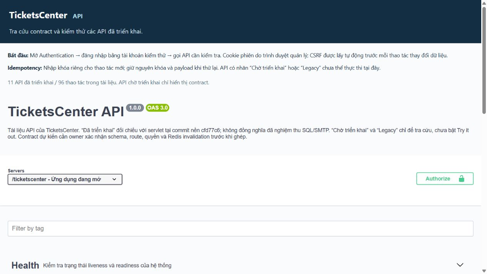
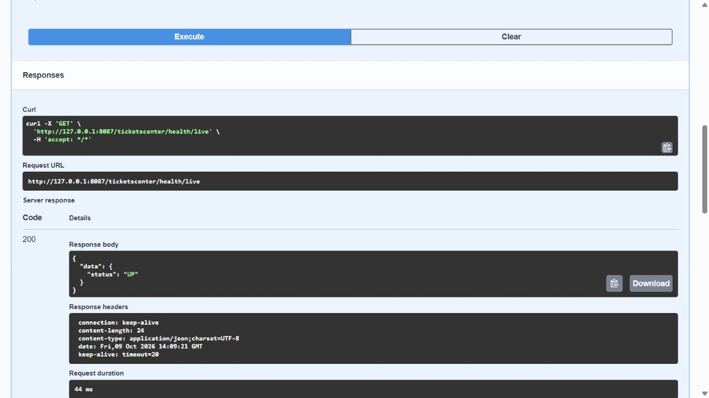

# VUONG-01 — Swagger UI, OpenAPI và Redis registry

- Issue: [#28](https://github.com/devonxjz/TicketCenter/issues/28).
- Owner: Vương (`l3vu0ng`). Bắt đầu: 09/10/2026, 20:24 UTC+7.
- Baseline: `dev` tại `cfd77c6`; nhánh `feat/vuong/vuong-01-swagger-redis-contract`.
- Phạm vi Swagger/registry được duyệt; bàn giao trên nhánh cục bộ, chưa push/PR/merge.

## Kết quả trong phiên

Swagger UI tĩnh hoạt động với OpenApiServlet đã có, không thêm dependency Maven. Gói asset chính thức 5.33.1 có license/checksum. UI dùng context hiện tại, cookie cùng origin, lấy CSRF trước mỗi mutation, giữ Idempotency-Key của caller và không persist authorization. Bộ lọc Try it out và interceptor cùng chặn API planned/legacy.

OpenAPI hiện có 89 paths / 96 operations: 11 implemented, 82 planned, 3 legacy. Đã đối chiếu các identity servlet hiện có: trường đăng ký/login/reset, current user, OTP response và envelope lỗi; readiness có schema riêng đúng source. Các contract dự kiến có owner, nguồn issue, operationId và nhãn yêu cầu owner review, chưa chốt schema đầy đủ. Public event catalog/detail/zones/seats/categories và IPN không đòi cookie; IPN vẫn phải verify chữ ký theo contract của Liêm.

[REDIS-REGISTRY.md](../../references/REDIS-REGISTRY.md) ghi cache, idempotency, lease, owner, TTL, scope và invalidation. Phân biệt producer hiện có với key dự kiến; ghi mâu thuẫn auth namespace/TTL, QR và IPN để phối hợp. Redis không thay quyền/transaction/chống lặp DB.

## Kiểm thử tự động

Lệnh chạy lại tại [runbook](../../backend/swagger-runbook.md). Lần kiểm tra cuối trong phiên:

| Kiểm tra | Kết quả |
|---|---|
| Nhóm JUnit an toàn gồm 10 test classes, chọn method không mở DB/gửi SMTP | 50 tests, 0 failures, 0 errors, 0 skipped |
| Node test trên initializer thật | 8 tests, 0 failures |
| HTTP smoke trên WAR giải nén/Tomcat isolated, ROOT và WAR context | 10 tests, 0 failures, 0 skipped |
| `mvn -B -DskipTests package` | BUILD SUCCESS, WAR chứa Swagger assets và spec |
| `git diff --check` | Không lỗi whitespace |

Test contract kiểm JSON duplicate keys, operationId/owner/status, reference và path parameter; regression cho identity/error, public security và readiness. Test JS chạy code thật trong VM, chỉ thay fetch boundary: WAR/root, giới hạn origin/context, CSRF thất bại/rotate, key replay, planned route và bodyless logout. Đã quan sát test đỏ trước khi sửa các lỗi selector argument order, OTP response, response writeOnly, public security/readiness và logout Content-Type.

## HTTP và trình duyệt

Smoke tự động tại [swagger-smoke.ps1](../../../src/test/scripts/swagger-smoke.ps1) dùng Tomcat 11.0.25/JDK25, port loopback tự chọn, hai context ROOT và `/ticketscenter`. Script giải nén WAR đã build vào thư mục mới `target/swagger-smoke/<run-id>`, cấu hình server riêng và tự dừng JVM. Deployment giới hạn vào servlet hiện có OpenAPI/Health/Readiness/CSRF/Login/Logout/Me cùng RequestValidationFilter, CsrfFilter và SessionValidationFilter; metadata-complete không khởi tạo persistence/listener/worker/SMTP. Đây là kiểm thử HTTP boundary, không phải nghiệm thu full WAR với DB. Lượt kiểm tra bằng trình duyệt trước đó dùng preview riêng tại `127.0.0.1:8087`.

| Tình huống | ROOT | /ticketscenter |
|---|---:|---:|
| Swagger UI và OpenAPI JSON | 200 | 200 |
| `/api/me` chưa đăng nhập | 401 | 401 |
| POST login JSON thiếu CSRF | 403 | 403 |
| POST login Content-Type không hỗ trợ | 415 | 415 |
| POST login body vượt 64 KiB | 413 | 413 |
| Token CSRF lấy từ phiên khác | 403 | 403 |
| POST login có CSRF cùng session, DB không khởi tạo | 503 DATABASE_UNAVAILABLE | 503 DATABASE_UNAVAILABLE |
| POST logout bodyless, JSON Content-Type và CSRF | 200 | 200 |
| Readiness khi registry không có | 503 DEPENDENCY_UNAVAILABLE | 503 DEPENDENCY_UNAVAILABLE |

Trình duyệt thực: health/live trả 200 với `data.status=UP`; Swagger logout tự lấy CSRF, gửi request qua hai filter và nhận 200 `data.loggedOut=true`. Root UI hiển thị server `/`; WAR hiển thị `/ticketscenter`. Mở API GET events planned có 0 nút Try it out. Ảnh overview không chứa credential/token:

Lần kiểm thử trình duyệt cuối xác nhận URL context hiện tại và HTTP 200/UP (44ms ở lượt quan sát, không phải benchmark):

Windows/JDK25 NIO connector gặp lỗi socket AF_UNIX ở môi trường máy này; smoke dùng NIO2 connector trong thư mục riêng. Không thay cấu hình Tomcat được cài hoặc source production. HTTP tests đặt timeout 5 giây trên mọi request, xác nhận byte/checksum asset được phục vụ từ WAR và context URL của initializer. Review bổ sung đã phát hiện và sửa việc kế thừa cấu hình server đã cài và request thiếu timeout.

## Đối chiếu tiêu chí issue

| Tiêu chí | Trạng thái / bằng chứng |
|---|---|
| SWG-01: giao diện Swagger 200 | Đạt qua HTTP/Tomcat cả hai context và trình duyệt |
| SWG-02: OpenAPI JSON 200, security schemes | Đạt qua HTTP và contract test |
| SWG-03: đăng nhập thật → catalog events | Chờ schema/DB test và servlet catalog của owner; chưa nghiệm thu |
| SWG-04: path và operationId không trùng | Đạt qua parser/contract test |
| SWG-05: không example credential/token | Đạt qua contract test và rà soát; evidence không ghi token phiên |

Ngày 09/10/2026, người dùng xác nhận nhóm **chưa có** schema owner đã chốt và môi trường DB test JDBC. Máy có SQL Server 2025 cục bộ nhưng không lắng nghe TCP1433 cho JDBC. Migration 026 cần schema legacy/tc_schema_migrations chưa có trong bộ cài hiện hành; `database/install.sql` dùng đường dẫn máy khác và schema.sql là BIGINT/users, không khớp mapping tc_users/UUID của WAR. Không bật TCP/restart DB đang dùng, không sửa migration/model của owner để giả lập nghiệm thu. Docker daemon cũng chưa chạy. Các điều kiện này được ghi lại làm đầu vào cho lần nghiệm thu toàn hệ thống.

## Giới hạn và việc còn lại trước khi đóng #28

1. Owner xác nhận schema/quyền/status/idempotency của 82 operations planned; các mô tả rút gọn không được coi là schema đã chốt.
2. Thái/Liêm/Khánh xác nhận các điểm auth namespace, QR và IPN trong Redis registry; owner bổ sung TTL còn thiếu.
3. Kiểm thử đăng nhập thật → catalog/events và các vai trò bằng DB/Redis/SMTP fixture của nhóm. Catalog chưa có servlet ở baseline nên SWG-03 của issue chưa nghiệm thu.
4. Full test/CI toàn repo chưa được chứng minh xanh. Java mặc định máy là 17, đã chọn JDK25 riêng cho terminal. SQL Server cấu hình sẵn từ chối IP máy khi thử baseline; full suite còn có test SMTP gửi email thật nên không tiếp tục chạy ngoài fixture. Không sửa credential, DB migration, pom hay code nghiệp vụ của đồng đội trong phiên này.
5. PR về dev, review đồng đội và CI xanh trước merge. Không dùng `Closes #28` khi các gate còn thiếu.
